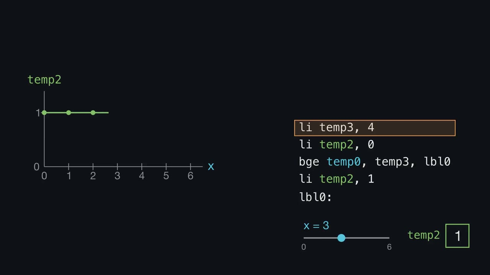

# CM Génération de code

Vidéo faite d'après les diapositives du CM6, CM7 et CM8 (Moodle), dans leur ordre et avec leurs exemples.

La machine RISC-V, code 3 adresses sur des temporaires puis allocation, schémas pour une constante, une comparaison et le if de l'exemple du cours, allocation tout en registres ou tout en mémoire, leaders, blocs de base et CFG, aperçu des optimisations locales.

Pour s'entraîner : [TD4](../td4_generation_code/).
