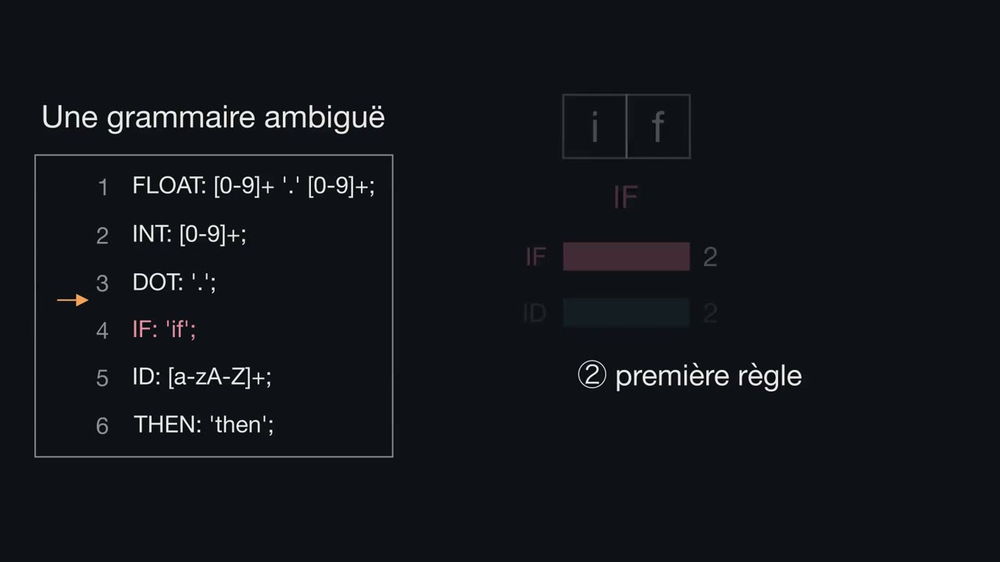

# CM Analyse lexicale et syntaxique

Vidéo faite d'après les diapositives du CM1 et CM2 (Moodle), dans leur ordre et avec leurs exemples.

Chaîne des phases, tokens, plus long préfixe puis première règle, grammaire et dérivation, grammaire ambiguë (priorité, associativité, choix d'ANTLR), arbre de dérivation contre AST, application type examen sur 1+2+3.

Pour s'entraîner : [TD1](../td1_lexer_parser/).
