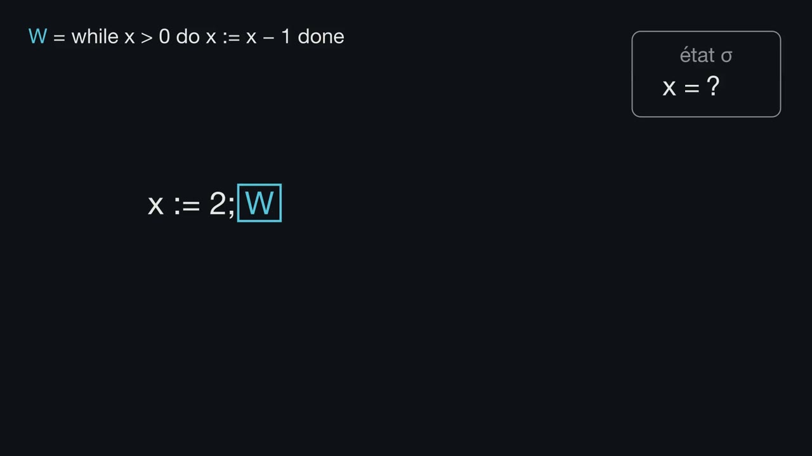

# CM Sémantique opérationnelle

Vidéo faite d'après les diapositives du CM5 (Moodle), dans leur ordre et avec leurs exemples.

États et Val, sémantique naturelle (règles et arbre de l'exemple), sémantique structurelle (règles et exemple pas à pas), déterminisme, équivalence, divergence, sûreté du typage (progrès, préservation).

Pour s'entraîner : [TD3](../td3_semantique/).
