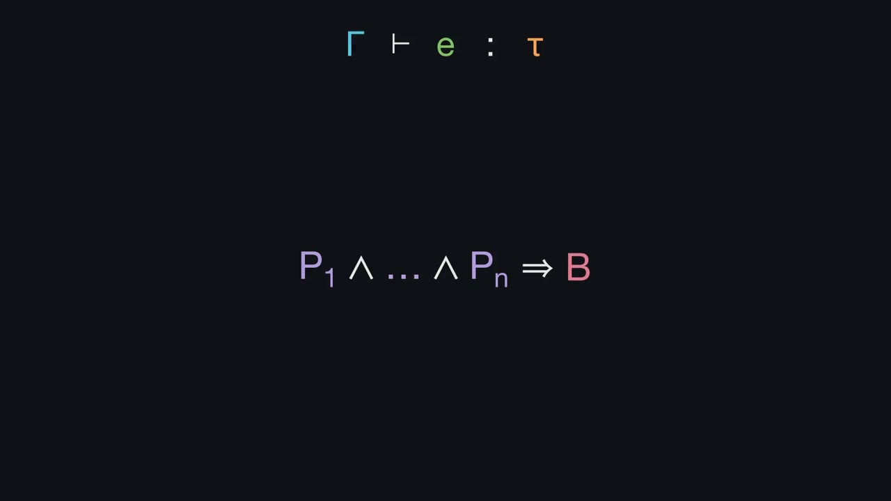

# CM Typage

Vidéo faite d'après les diapositives du CM4 (Moodle), dans leur ordre et avec leurs exemples.

Pourquoi typer, statique contre dynamique, le jugement Γ ⊢ e : τ, les huit règles de Mini-While, l'arbre de typage du cours règle par règle, un programme mal typé, le typeur comme visiteur.

Pour s'entraîner : [TD2](../td2_attributs_typage/).
