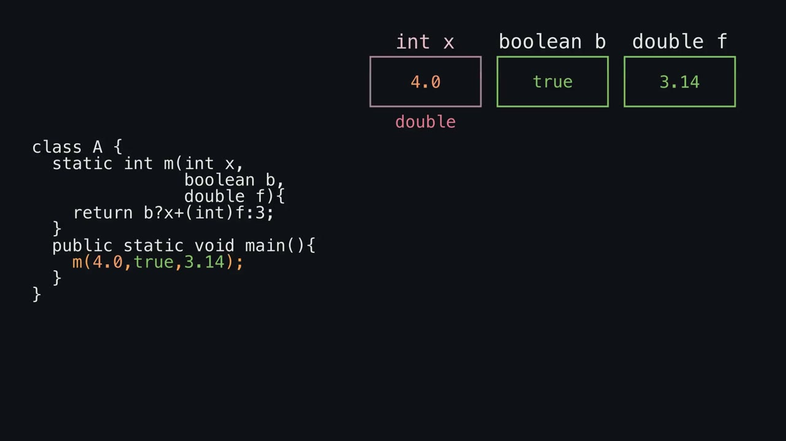
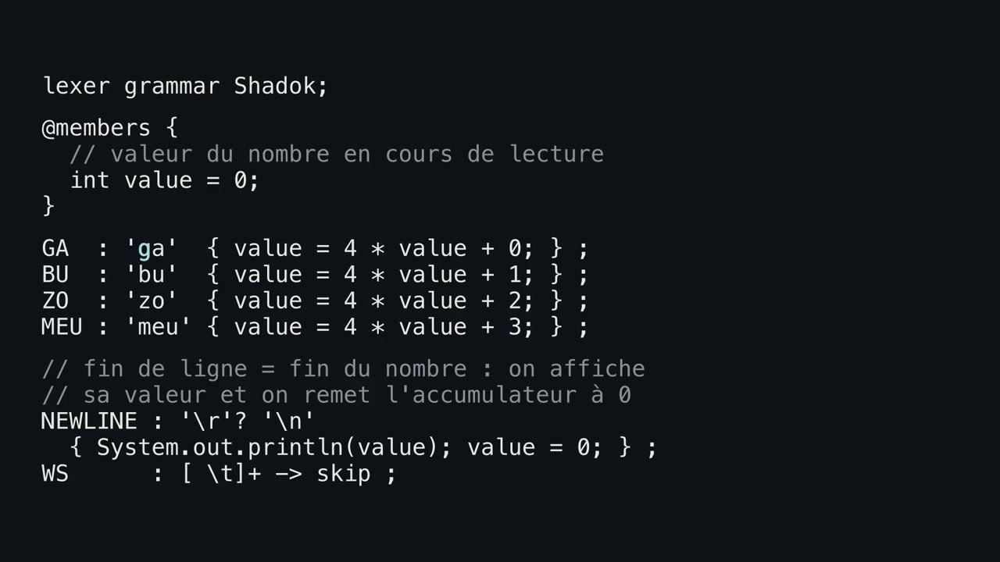

# Corrigé du TD1 : analyses lexicale et syntaxique

Corrigé détaillé en vidéo, question par question : énoncé, méthode, réponse pas à pas, piège classique.
Le même corrigé, écrit : [corrige.md](corrige.md). Le sujet est sur Moodle (Compilation > TD).

## Exercices 1.1 à 1.4

Quelle phase détecte l'erreur (8 programmes), propagation d'information dans `foo.c`, GIMPLE de `gcc`, syntaxe des regex ANTLR.

## Exercices 1.5 à 1.9

Règles de lexer (identificateurs, flottants, notation scientifique, mots-clés), nombres shadoks, parenthèses bien formées, arbres de la grammaire stratifiée et AST, grammaire MiniC.
