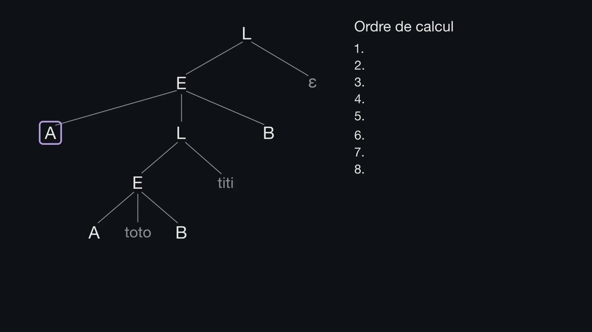
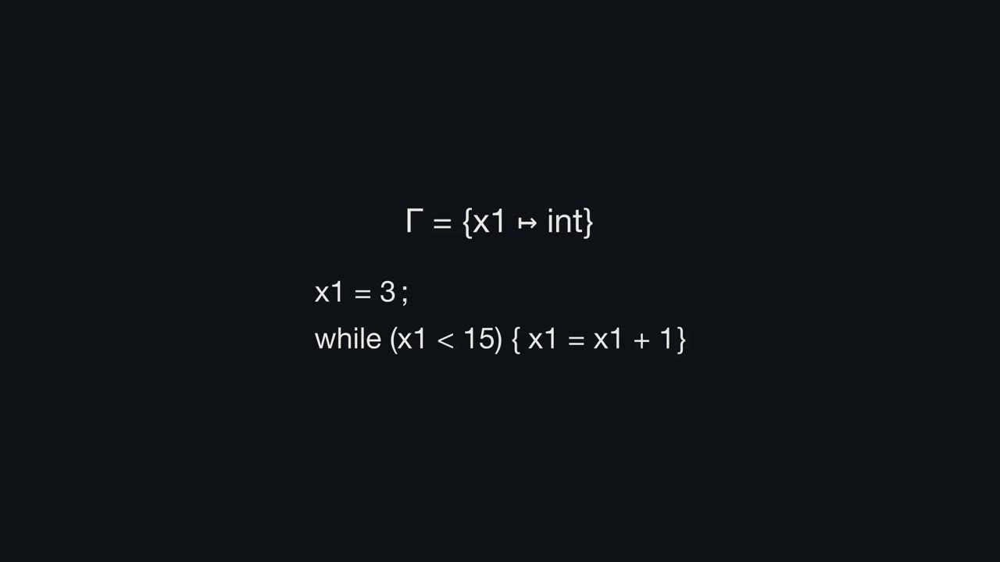

# Corrigé du TD2 : attributs et typage

Corrigé détaillé en vidéo, question par question : énoncé, méthode, réponse pas à pas, piège classique.
Le même corrigé, écrit : [corrige.md](corrige.md). Le sujet est sur Moodle (Compilation > TD).

## Exercices 2.1 à 2.3

Arbre de dérivation XML et attribut synthétisé, évaluation d'expressions par actions, attribut hérité pour `break`, bonus grammaire sans attribut.

## Exercices 2.4 à 2.8

C contre Python, arbre de typage complet, construction de Γ, règle du ternaire, deux règles pour `for`.
