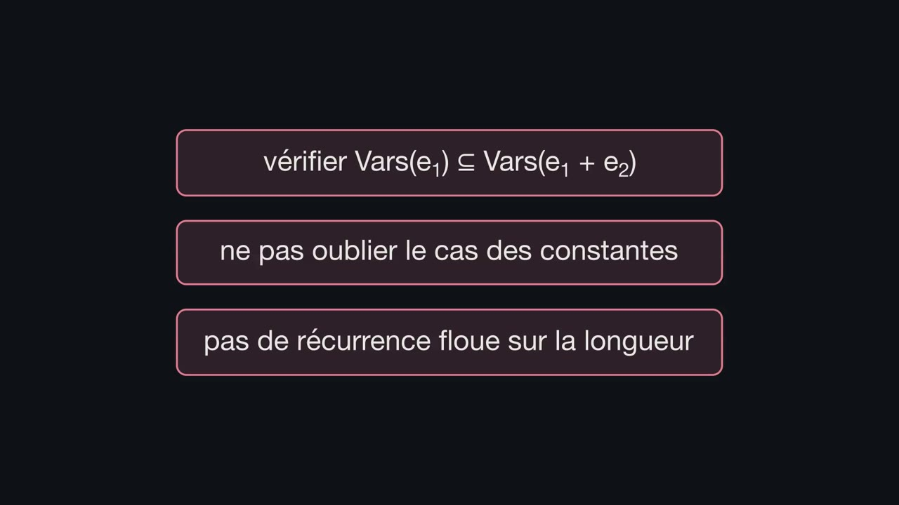
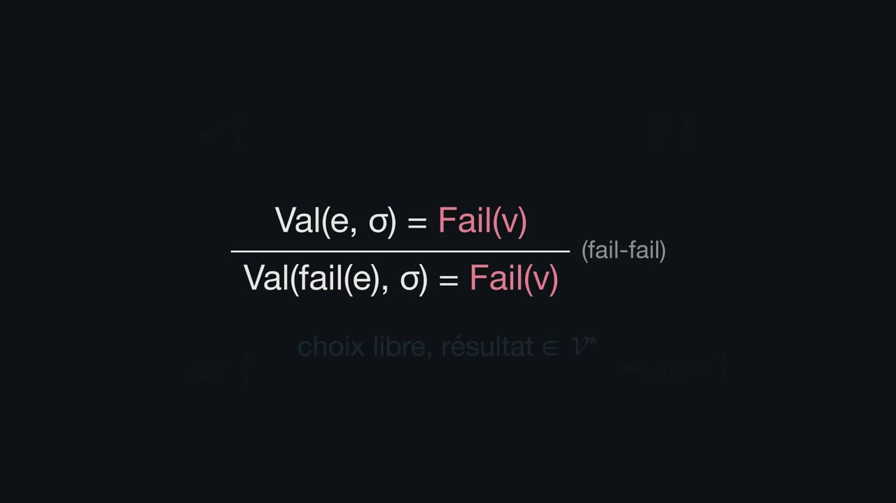

# Corrigé du TD3 : sémantique de MiniWhile

Corrigé détaillé en vidéo, question par question : énoncé, méthode, réponse pas à pas, piège classique.
Le même corrigé, écrit : [corrige.md](corrige.md). Le sujet est sur Moodle (Compilation > TD).

## Exercices 1 à 3

Val des expressions booléennes, preuves par induction (Vars, substitution), règles de `repeat` et élimination de `repeat`.

## §3.3

`fail` et `guard` : arbre de dérivation, règles du ternaire et de propagation, typage succès/échec, théorème de sûreté.
