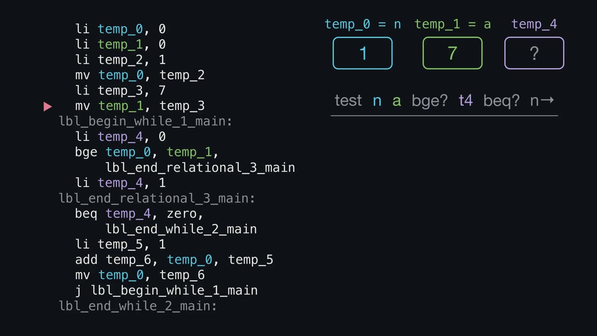
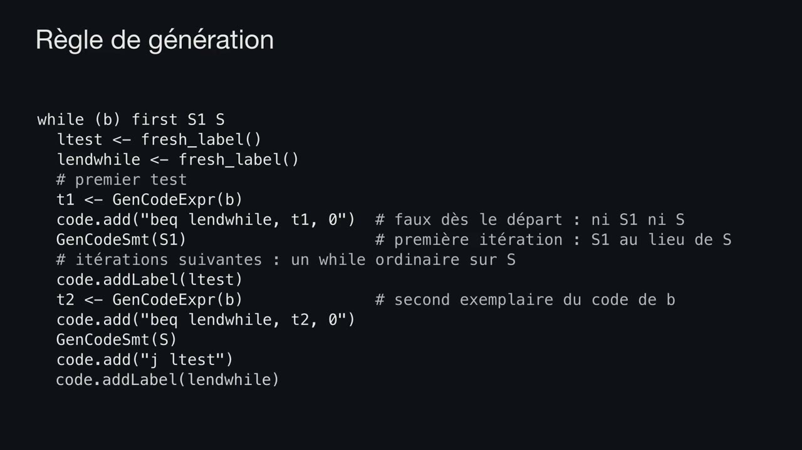

# Corrigé du TD4 : génération de code 3 adresses

Corrigé détaillé en vidéo, question par question : énoncé, méthode, réponse pas à pas, piège classique.
Le même corrigé, écrit : [corrige.md](corrige.md). Le sujet est sur Moodle (Compilation > TD).

## Exercices 4.1 à 4.4

Un `while` compilé à la main et simulé, code à trous, règle pour `xor`, règle pour `ifz`.

## Exercices 4.5 à 4.8

`repeat`, `while first`, `for`, allocations naïve et tout en mémoire.
