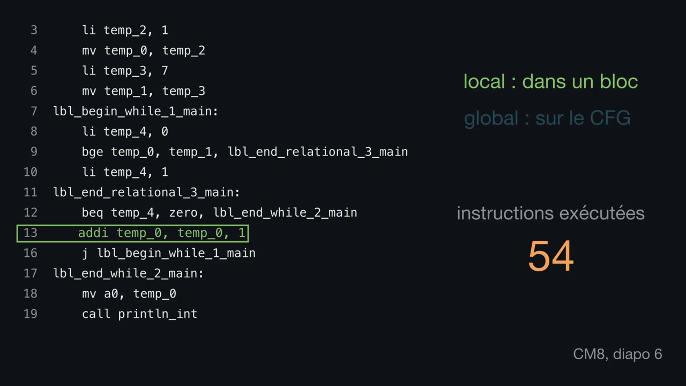
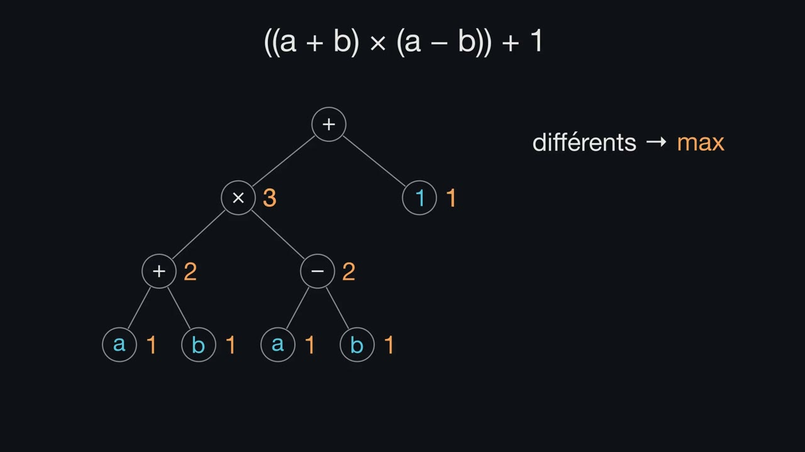
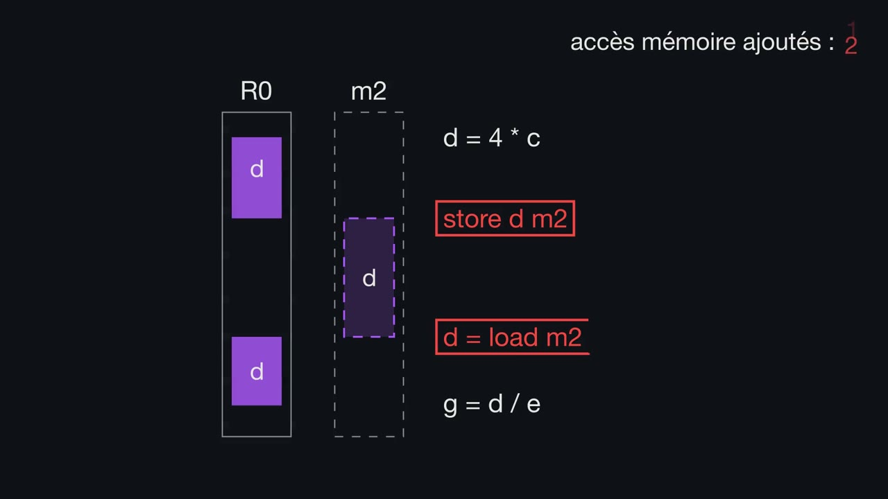

# Corrigé du TD5 : CFG et optimisations locales

Corrigé détaillé en vidéo, question par question : le cours utile, la méthode, la réponse pas à pas, le piège classique.
Le même corrigé, écrit : [corrige.md](corrige.md). Les scripts qui ont vérifié chaque résultat : [verification/](verification/). Le sujet est `ensimag_compil_td5.pdf` (Moodle, Compilation > TD).

## Exercices 1 et 2 : blocs de base et graphe de flot de contrôle

Leaders, blocs de base, arcs du CFG, programme MiniC source, code 3 adresses et CFG de la boucle `while (x < 4)`.

## Exercices 3 et 4 : ordonnancement et Sethi-Ullman

Intervalles de vie, pression sur les registres, calcul de ρ sur l'arbre, code de Sethi-Ullman comparé au code gauche-droite du CM7.

## Exercices 5 et 6 : allocation de registres locale

Allocation avec six registres (3 suffisent), idée du bin packing et du linear scan, allocation avec deux registres et spill (3 load et 2 store ajoutés, le minimum).
