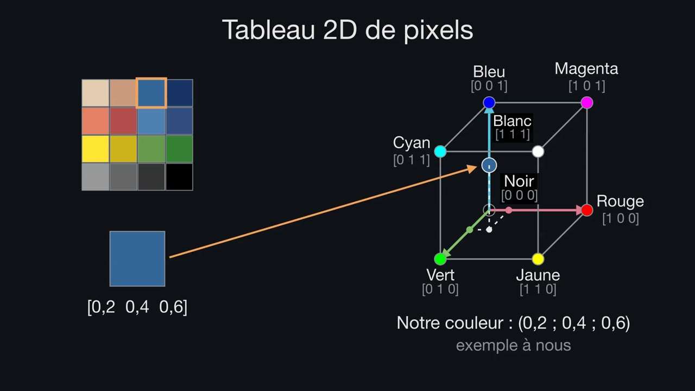

# CM1 Introduction : image, couleur, maillages, caméra

Vidéo faite d'après les diapositives du CM1 « 3D Graphics : Introduction » (Moodle), dans leur ordre et avec leurs exemples.

Pixels et RGB, vision humaine, gamut, conversions RGB vers CMYK et vers HSL, scène, pourquoi des triangles, triangle soup contre indexed triangle (question mémoire), autres représentations, caméra et frustum.
