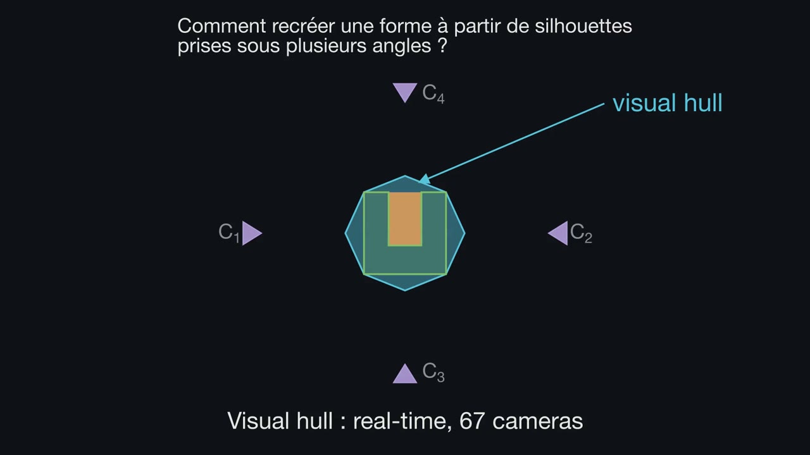

# CM5 Représentations de la géométrie et visual hull

Vidéo faite d'après les diapositives du CM5 « Geometry representations / Shape recovery » de Marco Freire (Moodle), dans leur ordre et avec leurs exemples.

Trois formes d'une droite et la bonne forme pour chaque tâche, explicite contre implicite (maillages, nuages de points, SDF, voxels, neural implicits), silhouettes, visual hull et son algorithme sur une grille de voxels.
