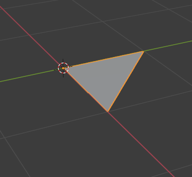
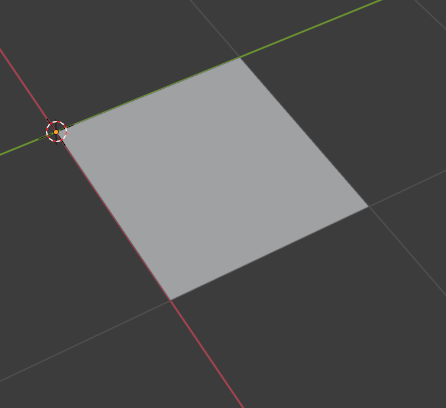
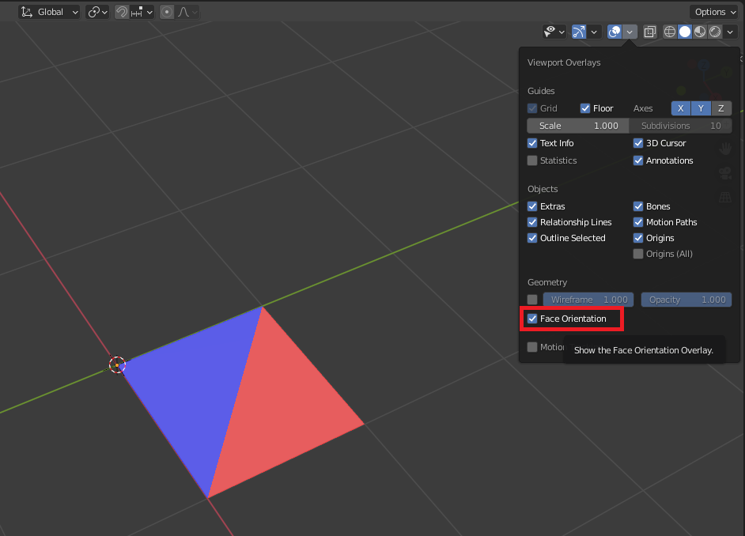
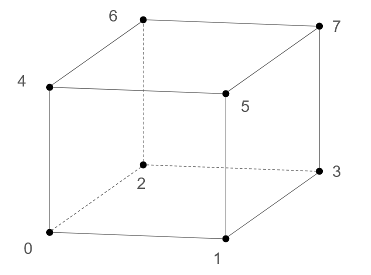
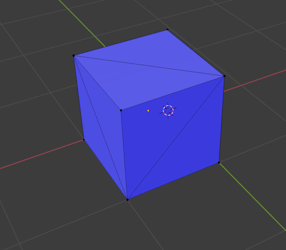
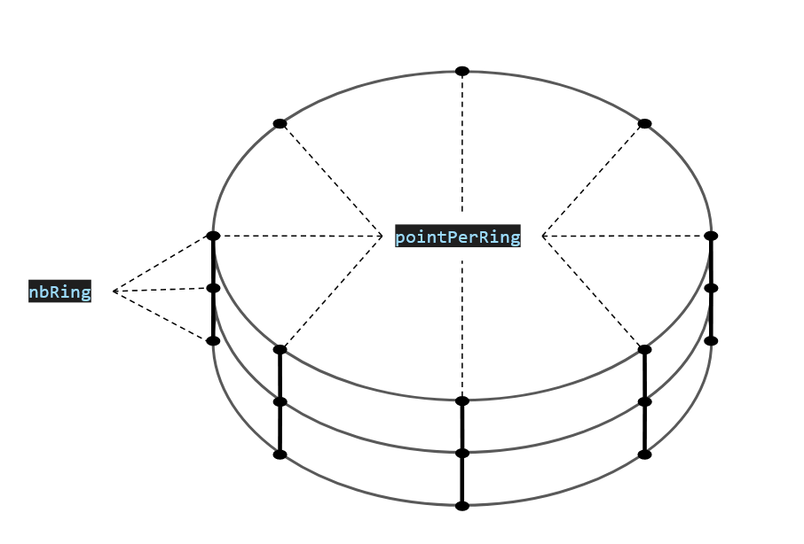
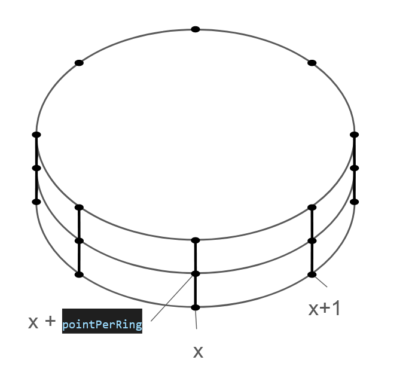
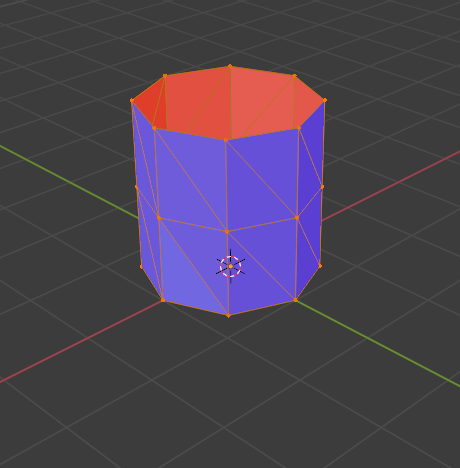

### 1- Generate a triangle 

*Reminder: a triangle is an array of 3 vertices, and a vertex is an array of three coordinates.*

To represent a triangle in Python we will use a numpy array :

``` python
import numpy as np
vertices = np.array([
  [0.0,0.0,0.0], #first vertex
  [1.0,0.0,0.0], #second vertex
  [0.0,1.0,0.0], #third vertex
])
```

In this practical work, we will represent meshes with the indexed representation so we need to represent each triangle with an array of three indices pointing toward vertices in the previous array.

``` python
triangles = np.array([
  [0,1,2] # create a triangle with the first, second, and third vertices
], dtype=int)
```

Now to visualize our triangle we will export it as a ply file using the following command:

``` python
from exportToPly import write_ply_file
write_ply_file(vertices,triangles, 'triangle.ply' )
```

Once executed this script will generate a triangle.ply file. Now we can import the file in Blender to visualize it. To do so open Blender, use file \> import \> Stanford (.ply), and select the file you created.

Once imported you should see something like this :



### 2- Generate a square instead of a triangle 

*Hint: you need to add one vertex to the vertices array, and one triangle to the triangle array.*

Once you did the modification to your scrip, import it into Blender, you should see something similar to this:



Now to check if our triangles are correctly oriented, we can use Blender to visualize the orientation of our faces:



(If you don't have these colors make sure only the object you want to visualize is in the scene)

If the triangles you generated are of different colors it means the orientation of your triangles is not coherent. To change that, you can modify the order of the indices of the triangle you added in your script.

In general, we want to have faces oriented coherently, which will simplify a lot of computation in future practical work.

###  

### 3- Generate a cube

In this exercise, your goal is to generate the following cube :



Using the following vertices :

``` python
vertices = np.array([
  [0.0,0.0,0.0], #0
  [1.0,0.0,0.0], #1
  [0.0,1.0,0.0], #2
  [1.0,1.0,0.0], #3
  [0.0,0.0,1.0], #4
  [1.0,0.0,1.0], #5
  [0.0,1.0,1.0], #6
  [1.0,1.0,1.0], #7
])
```

Once the cube is generated it should look like this:



All the triangles of the cube should be blue in Blender.

*Hint: each face of the cube should generate 2 triangles.*

### 4-Generate a cylinder

In this part, we will focus on creating a script that can generate the mesh of a cylinder.

First, we will define two variables that will define how we will subdivide the cylinder :

``` python
pointPerRing = 8
nbRing = 3
```



Then we need to define all the vertices we need to

``` python
vertices = []

for i in range (nbRing) :
  for j in range (pointPerRing) :
	x= #todo
	y= #todo
	z= #todo
	vertices.append([x,y,z])
vertices = np.array(vertices)
	
```

*Hint: Given an angle phi you can find a point on a circle using cos(phi), sin(phi). In mathematics libraries, angles are expressed in radians \[0, 2pi\].*

Finally, we need to define all the triangles. If you followed the instructions above, the vertices should be stored as follows:



Where given a vertices at the index x, its neighbors should be at x±1 and x ± pointPerRing.

Using this information generate the triangle that composes the following cylinder.



All triangles should be blue when looked at from the exterior.

Optional: modify the script to close the top and the bottom of the cylinder

### 5- Generate a sphere

Now write a function that generates a sphere, using the **same input parameters as the cylinder**: `pointPerRing` and `nbRing`.

``` python
pointPerRing = 8
nbRing = 8
radius = 1.0
```

As with the cylinder, each ring will contain `pointPerRing` vertices placed around a circle, and rings are stacked to form the full mesh:

``` python
vertices = []

for i in range (nbRing) :
  for j in range (pointPerRing) :
	x= #todo
	y= #todo
	z= #todo
	vertices.append([x,y,z])
vertices = np.array(vertices)
```

The triangle indices follow the exact same pattern as the cylinder above: a vertex at index x is connected to its neighbors at x±1 and x±pointPerRing.

**Be careful how you space the rings.** If you space the rings using values of z evenly spaced between -radius and +radius, the segments connecting one ring to the next will be short near the equator and much longer near the poles, giving triangles of very different sizes across the sphere. This is *not* what we want: the rings should be spaced so that every segment going from one ring to the next has roughly the same length.

*Hint: you already used an angle with cos/sin to place the points around a single ring. The same idea can be used along the other direction, to place the rings themselves.*
