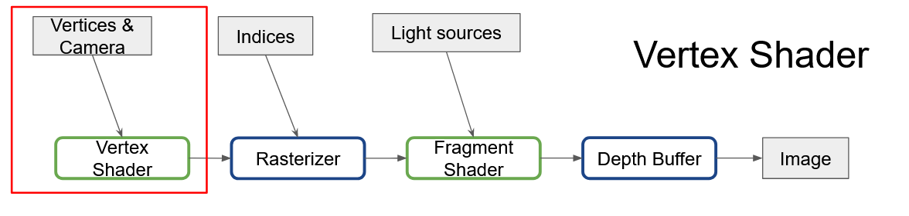
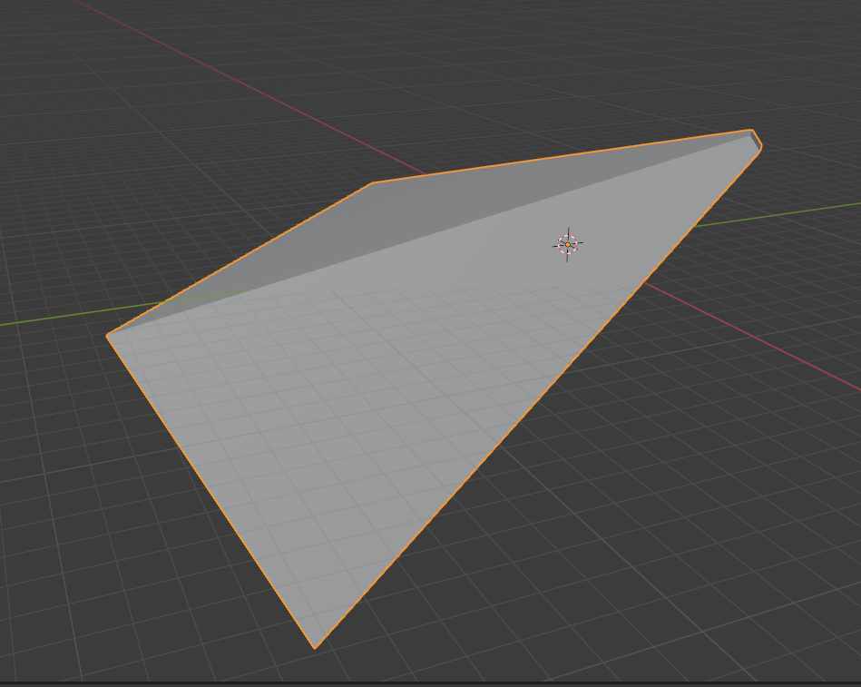
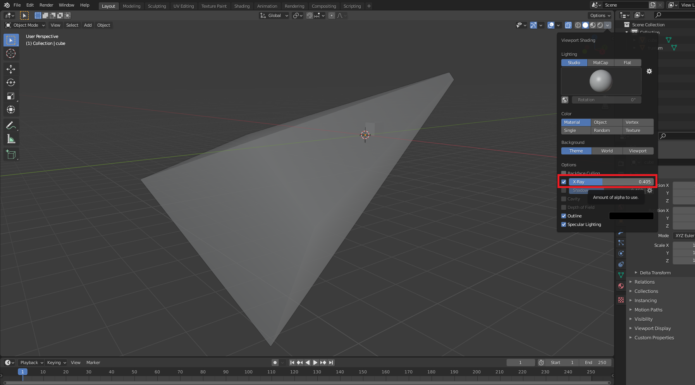
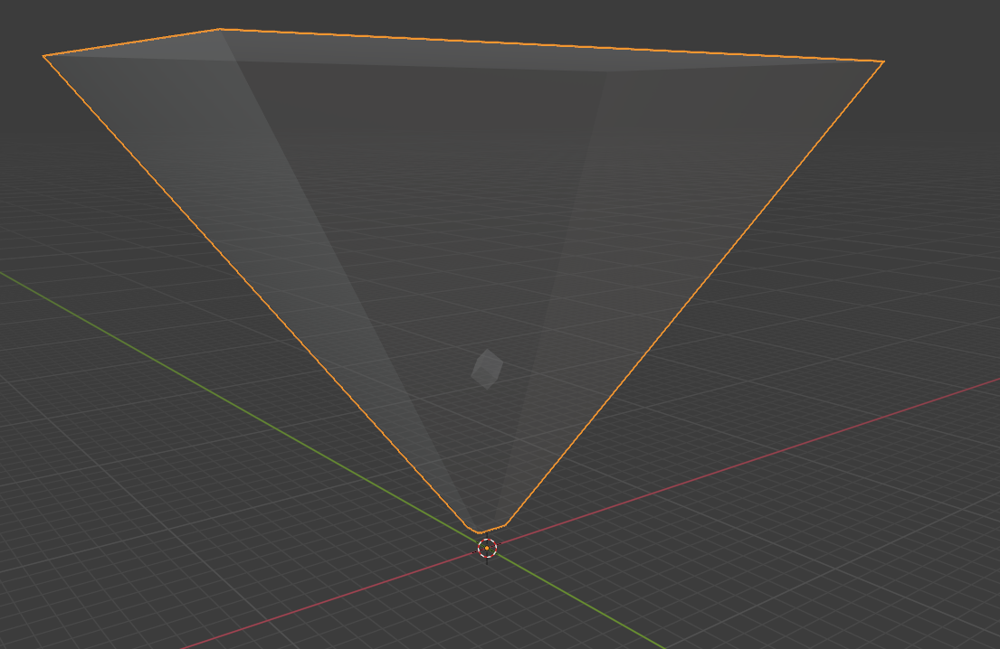
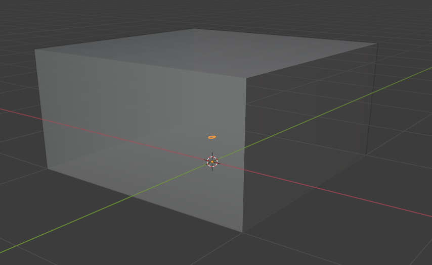

The goal of this practical work is to implement a vertex shader. The vertex shader is the first stage of our rendering pipeline:



It takes vertices expressed in the scene space and camera information as inputs and output vertices re-expressed in the projected space.

First, let\'s define our scene, for that, we'll reuse the code to create a cube from the previous practical work:

``` python
vertices = np.array([
  [0.0,0.0,0.0], #0
  [1.0,0.0,0.0], #1
  [0.0,1.0,0.0], #2
  [1.0,1.0,0.0], #3
  [0.0,0.0,1.0], #4
  [1.0,0.0,1.0], #5
  [0.0,1.0,1.0], #6
  [1.0,1.0,1.0], #7
])

triangles = np.array([
  [1,0,2],
  [3,1,2],
  [4,5,6],
  [5,7,6],
  [0,1,4],
  [4,1,5],
  [2,6,3],
  [3,6,7],
  [0,6,2],
  [4,6,0],
  [1,3,7],
  [5,1,7]
], dtype=int)
```

Then we need to define a camera for that you'll need the camera.py and the projection.py files.

The first one contains a class that will help us define a Camera in space :

``` python
import numpy as np

class Camera:
  def __init__(self, position, lookAt, up, right) :
    self.position = position
    self.lookAt = lookAt
    self.up = up
    self.right = right

  def getMatrix(self):
    #todo
    pass
```

The second one will help us define the part of the camera space seen by the camera (frustum):

``` python
import numpy as np

class Projection:
  def __init__(self, near,far,fov,aspectRatio) :
    self.nearPlane = near
    self.farPlane = far
    self.fov = fov
    self.aspectRatio = aspectRatio

  def getMatrix(self) :
    #todo
    pass
```

Let\'s create a camera with the following command:

``` python
position = np.array([5,5,5])
lookAt = np.array([-0.577,-0.577,-0.577])
up = np.array([0.33333333,  0.33333333, -0.66666667])
right = np.array([-0.57735027,  0.57735027,  0.])

cam = Camera(position, lookAt, up, right)
```

And a projection :

``` python
nearPlane = 1.0
farPlane = 20.0
fov = 1.22173
aspectRatio = 16/9

proj = Projection(nearPlane ,farPlane,fov, aspectRatio)
```

Now using the following lines we will export a representation of the Frustum:

``` python
from generateFrustum import generateFrustum
generateFrustum(cam, proj)
```

This should create a frustum.ply file that we can open in Blender, you should see the following:



Now we can export our cube as we did in the previous practical work using the following commands:

``` python
from exportToPly import write_ply_file
write_ply_file(vertices,triangles, 'cube.ply' )
```

Import it in Blender and activate the x-ray mode in blender you should see something like this:



As you can see our cube is inside the frustum so it is visible to the camera. Now try changing the parameters of the projection to see how they affect the frustum shape.

## Question 1: Vertex shader and camera space 

The job of the vertex shader is to re-express each vertex in the projected space frustum space

We first need to project all vertices in the camera space to do that. For this operation, we need the view matrix as seen in the lectures.

**1)Modify the getmatrix function in the Camera class such that it returns the view matrix.**

**2) Call this function on the camera we defined, and store the result in a dictionary as follows:**

``` python
data = dict([
  ('viewMatrix',cam.getMatrix()),
])
```

**3) open the graphicPipeline.py file and modify the vertex shader function such that it applies the camera matrix on the vertex it receives:**

``` python
def VertexShader(self, vertex, data) :
   outputVertex = np.zeros_like(vertex)
  
   #todo

   return outputVertex
```

**4) call your vertex shader using the following lines :**

``` python
from graphicPipeline import GraphicPipeline
pipeline = GraphicPipeline()
pipeline.draw(vertices, triangles, data)
```

**5) export your scene in the camera space with the following lines:**

``` python
from generateFrustum import generateFrustumCameraSpace
newvertices = pipeline.newVertices
generateFrustumCameraSpace(proj)
write_ply_file(newvertices,triangles,'cubeCamera.ply' )
```

It should generate two ply files, one named frustumCameraSpace.ply and one named cubeCamera.ply, if you open them in Blender you should see the following :



As you can see now our frustum is aligned on the three main axes of the scene, and our cube is still at the same position inside the frustum.

Now we need to apply the projection to represent the visible part of the screen in a cube rather than in a frustum as it will simplify future operation

## Question 2: Vertex shader and Project space

**1) Modify the getmatrix function in the Projection Class to return the projection matrix.**

**2) Modify the data dictionary to add the projection matrix:**

``` python
data = dict([
  ('viewMatrix', cam.getMatrix()),
  ('projMatrix', proj.getMatrix())
])
```

**3) Modify the Vertex Shader to project all vertex in the projected space.**

(do not forget to divide the x,y, and z coordinates by w to correctly apply the projection).

Export the projected mesh and the projected frustum with the following lines:

``` python
write_ply_file(newvertices,triangles, 'cubeProjected.ply' )
from generateFrustum import generateProjectedFrustum
generateProjectedFrustum()
```

In Blender you should see the following:



As you can see the cube is now very small and its shape changed. It is normal, as the projected space is a lot smaller than the shape of the space went from a pyramid to a Rectangular cuboid.

**4) Try to play with the camera and projection parameter to seed how it affect the position of the cube in the projected space**

## Question 3: Solar system

So far, the matrices we used (view, projection) only transform vertices to move them from the scene to the camera, and then to the projected space. We are now going to use matrices for a different purpose: placing objects inside the scene itself, before the camera even sees them. This transformation is called the **model matrix**.

We will build a small solar system made of a sun, a few planets orbiting around it, and at least one satellite (a moon) orbiting one of the planets, reusing the sphere you generated in the previous practical work (TP1, exercise 5).

**1) Reuse the function you wrote in TP1 to generate a single unit sphere (radius = 1, centered on the origin), and store its `vertices` and `triangles` arrays. This same mesh will be reused for the sun, every planet, and every moon: only the model matrix applied to it will change.**

**2) Write functions that build the following 4x4 matrices in homogeneous coordinates:**

``` python
def scaleMatrix(s) :
  #todo
  pass

def translationMatrix(t) :
  #todo
  pass

def rotationMatrixY(angle) :
  #todo
  pass
```

**3) For a planet, define its model matrix as a function of time `t`, combining a scale (its radius), a translation (its distance to the sun, i.e. its orbit radius), and a rotation around the sun (its position on its orbit at time `t`):**

``` python
def planetModelMatrix(t, orbitRadius, planetRadius, orbitSpeed) :
  S = scaleMatrix(planetRadius)
  T = translationMatrix(np.array([orbitRadius, 0.0, 0.0]))
  R = rotationMatrixY(t * orbitSpeed)
  return R @ T @ S
```

*Be careful about the order of the multiplications: the sphere must first be scaled to the right size, then moved away from the sun, and only then rotated around the sun.*

**4) For a moon, its model matrix must place it relative to its planet: it first orbits its planet, and the result is then affected by the planet's own model matrix.**

``` python
def moonModelMatrix(t, planetMatrix, moonOrbitRadius, moonRadius, moonOrbitSpeed) :
  S = scaleMatrix(moonRadius)
  T = translationMatrix(np.array([moonOrbitRadius, 0.0, 0.0]))
  R = rotationMatrixY(t * moonOrbitSpeed)
  return planetMatrix @ R @ T @ S
```

**5) Add a `modelMatrix` entry to the `data` dictionary, and modify the `VertexShader` function so that it applies the model matrix to the vertex before the view and projection matrices:**

``` python
data = dict([
  ('modelMatrix', modelMatrix),
  ('viewMatrix', cam.getMatrix()),
  ('projMatrix', proj.getMatrix())
])
```

**6) For a given value of `t`, call `pipeline.draw` once per celestial body (the sun, each planet, each moon), each time with a different `modelMatrix` in `data`, and export every resulting mesh (e.g. into the same ply file, or one file per body) so you can visualize the whole solar system in Blender.**

*Hint: the sun stays at the origin and does not orbit, so its model matrix only needs a scale.*

**7) Generate the solar system for several values of `t` (e.g. `t = 0, 1, 2, ...`) and export a ply file for each one. Import the sequence in Blender to check that the planets and moons move along their orbit as `t` increases, while staying at a constant distance from the sun (or from their planet, for the moons).**

Optional: give each planet its own orbit inclination by combining `rotationMatrixY` with a rotation matrix around another axis.
