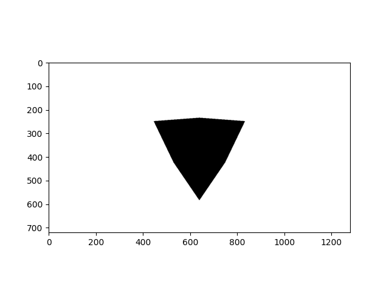
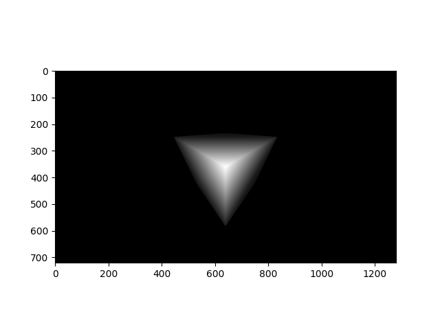

In this part, we aim to implement a rasterizer as seen in the lecture.

First, you need to download the camera.py, projection.py, and graphicPipeline.py.

Then you need to complete the graphicPipeline.py :

``` python
import numpy as np

class Fragment:
  def __init__(self, x : int, y : int, depth : float):
    self.x = x
    self.y = y
    self.depth = depth

def edgeSide(p, v0, v1) :
  pass
  #todo

class GraphicPipeline:
  def __init__ (self, width, height):
    self.width = width
    self.height = height
    self.depthBuffer = np.ones((height, width))

  def VertexShader(self, vertex, data) :
    outputVertex = np.zeros_like(vertex)
    x = vertex[0]
    y = vertex[1]
    z = vertex[2]
    w = 1.0

    vec = np.array([[x],[y],[z],[w]])
    vec = np.matmul(data['projMatrix'],np.matmul(data['viewMatrix'],vec))

    outputVertex[0] = vec[0]/vec[3]
    outputVertex[1] = vec[1]/vec[3]
    outputVertex[2] = vec[2]/vec[3]

    return outputVertex

  def Rasterizer(self, v0, v1, v2) :
    fragments = []

    for j in range(0, self.height) :
      for i in range(0, self.width) :
        #x = ...
        #y = ...

        #if inside
          #emit a fragment
        pass
   
    return fragments

  def draw(self, vertices, triangles, data):
    self.newVertices = np.zeros_like(vertices)

    for i in range(vertices.shape[0]) :
       self.newVertices[i] = self.VertexShader(vertices[i],data)

    fragments = []
    for t in triangles :
      #call the rasterizer the triangle t
      pass

    for f in fragments:
      #todo Process each fragment using the depth buffer
      pass
```

### Inside outside test

To do so you should start by completing the edgeSide Function then implement the inside-outside test in the rasterizer and emit a fragment when it is needed. (For now, use 0 for the depth of the fragments )

Then as a first test, fill the depth buffer with fragment z regardless of the current depth buffer.

To test your code you can use the following code :

``` python
import numpy as np

from graphicPipeline import GraphicPipeline
width = 1280  
height = 720
pipeline = GraphicPipeline(width,height)

from camera import Camera
position = np.array([1.1,1.1,1.1])
lookAt = np.array([-0.577,-0.577,-0.577])
up = np.array([0.33333333,  0.33333333, -0.66666667])
right = np.array([-0.57735027,  0.57735027,  0.])
cam = Camera(position, lookAt, up, right)

from projection import Projection
nearPlane = 0.1
farPlane = 10.0
fov = 1.91986
aspectRatio = width/height
proj = Projection(nearPlane ,farPlane,fov, aspectRatio)

vertices = np.array([
  [0.0,0.0,0.0], #0
  [1.0,0.0,0.0], #1
  [0.0,1.0,0.0], #2
  [1.0,1.0,0.0], #3
  [0.0,0.0,1.0], #4
  [1.0,0.0,1.0], #5
  [0.0,1.0,1.0], #6
  [1.0,1.0,1.0], #7
])

triangles = np.array([
  [1,0,2],
  [3,1,2],
  [4,5,6],
  [5,7,6],
  [0,1,4],
  [4,1,5],
  [2,6,3],
  [3,6,7],
  [0,6,2],
  [4,6,0],
  [1,3,7],
  [5,1,7]
], dtype=int)

data = dict([
  ('viewMatrix',cam.getMatrix()),
  ('projMatrix',proj.getMatrix())
])

pipeline.draw(vertices, triangles, data)

import matplotlib.pyplot as plt
imgplot = plt.imshow(pipeline.depthBuffer, cmap='gray')
plt.show()
```

It should give you the following image :

(As we didn't use any optimization the operation might take some time to complete)



### Depth buffering

1\) Compute the depth of each fragment in the Rasterizer function

2\) In the draw function, modify the loop over fragments to use the depth testing

3\) In the main file replace the line:

``` python
imgplot = plt.imshow(pipeline.depthBuffer, cmap='gray')
```

By:

``` python
imgplot = plt.imshow(1/pipeline.depthBuffer, cmap='gray')
```

You should obtain the following image :



###  Optimisation :

Implement The Axis Aligned bounding box optimization to reduce computation times.

If correctly implemented it should significantly decrease computation times

Measure the rendering time without the optimization and with it.

### Scan line rasterization

The rasterizer you implemented above tests every pixel of the image (or of the bounding box) independently against the triangle. Another classical way to rasterize a triangle is the **scan line algorithm**, which exploits the fact that the triangle's edges are straight lines: for a given row of the image, the set of pixels inside the triangle is a single contiguous segment, whose left and right bounds can be computed directly from the edges instead of being found by testing every pixel.

The algorithm works as follows :

1\) Compute the screen space coordinates of the three vertices, then sort them by increasing y so that you have a top, a middle, and a bottom vertex.

2\) For each row y between the top and the bottom vertex, compute the x coordinates at which that row crosses the triangle's edges (using a linear interpolation along the edges, similar to what you use for barycentric interpolation).

3\) Between those two x bounds (clipped to the image), emit a fragment for each pixel, computing its depth (and any interpolated data) the same way as before.

Implement this algorithm in a new method of `GraphicPipeline`:

``` python
def RasterizerScanLine(self, v0, v1, v2) :
  fragments = []
  #todo
  return fragments
```

Add a way to choose which rasterizer (the one from the previous section, or this new scan line one) is used by the `draw` function, for example by adding a parameter to `draw`, so that both implementations remain available.

### Comparing the two approaches

Using the `time` module (as in the Optimisation section), measure and compare the total rendering time of the scene obtained with:

- the pixel/bounding box rasterizer implemented earlier,
- the scan line rasterizer you just implemented.

Run each version several times to get a stable measurement, and report the average computation time of each approach.

Then answer the following questions :

- Which of the two approaches is faster on this scene ? By roughly what factor ?
- Why does the scan line algorithm avoid some of the work done by the pixel/bounding box approach ?
- Do you expect the difference between the two approaches to grow or shrink with the image resolution ? With the size of the triangles on screen ? Justify your answer.
