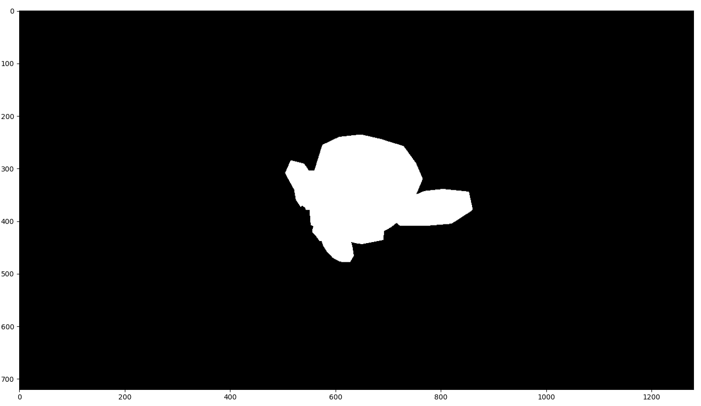
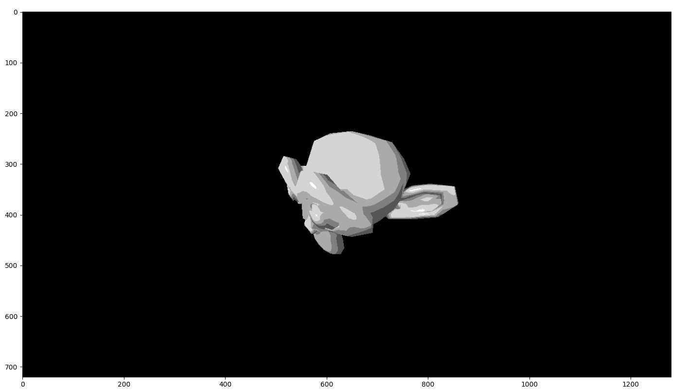
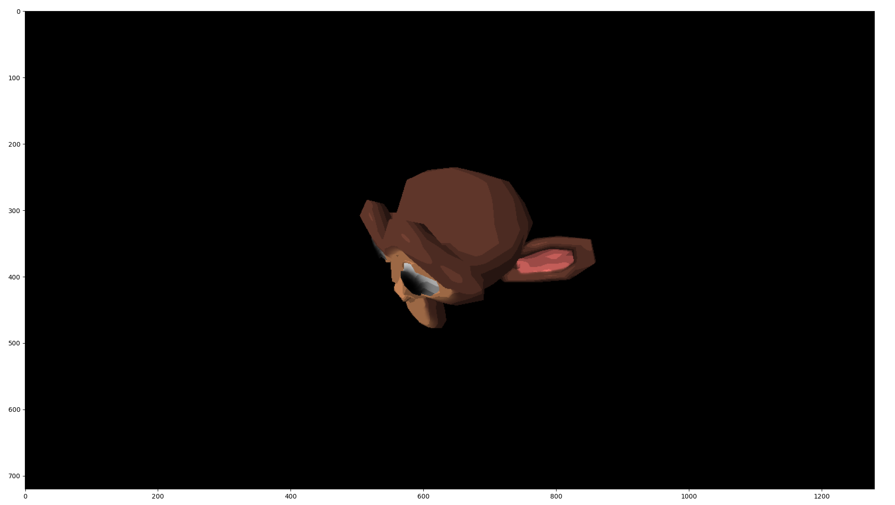

1)  For each fragment call the fragment shader. Then if the fragment passes the depth test store its output in the final image using the following command:

> ``` python
>  self.image[f.y][f.x] = f.output
> ```
>
> Now if you run the main.py file, you should get the following image :
>
> 
>
> This result is normal, if you look at the fragmentShader function, it creates a white output in each fragment, we need to change that to improve our result.

2)  Modify the vertex shader to compute the vectors V and L, and store N, V, and L at the end of the projected vertex.

> (the camera position and light position are stored in the data variable)

3)  Modify the rasterizer to compute the interpolation of the vertex data for each fragment.

> To do so use the barycentric coordinate we computed in the previous lab.
>
> Interpolate the vertex data to find their value at the point p, and store it in the associated fragment.

4)  In the fragmentShader function unpack the vectors N, V, and L from the fragment interpolated data and use them to compute the phong illumination.\
    > For the moment use modelColor = \[1,1,1\], α=32, ki = 0.1, kd = 0.9, and ks = 0.3

> Now if you run main.py you should obtain the following image:
>
> 
>
> Try modifying the fragmentShader function only to show the effect of the ambient light.\
> Do the same for the diffuse light, and the specular light.
>
> What part of the result is affected by the different parts of the phong shading?
>
> Now try to change the value of ki, kd, ans ks to see how it affects the result

### Stylization 

The result above is nice, it is close to how a real object would look. In some cases, we want to be able to render objects in a non-realistic way this is called Expressive rendering.

One method to render objects to give them a more cartoonish aspect is the cel-shading, It makes rendered objects appear more flat by reducing the number of shades present in the image

Try to modify your fragment shader to obtain the following result:



### Texture 

Without texture, rendering can look dull, to fix that let's try to load and apply a texture to Suzanne.\
\
1) Load the texture with the following line :

``` python
from PIL import Image
from numpy import asarray
# Open the image form working directory
image = asarray(Image.open('suzanne.png'))
```

2\) Add the texture to the data array :

``` python
data = dict([
 ('viewMatrix',cam.getMatrix()),
 ('projMatrix',proj.getMatrix()),
 ('cameraPosition',position),
 ('lightPosition',lightPosition),
 ('texture', image),
])
```

3\) Modify the vertex shader to pass the UV coordinates to the rest of the pipeline

4\) Modify the fragment shader to sample the texture and multiply the Phong shading by the sampled color to obtain the final color.\
To sample the texture use the following function :

``` python
def sample(texture, u, v) :
   u = int(u * texture.shape[0])
   v = int((1-v) * texture.shape[1])
   return texture[v,u] / 255.0
```

You should obtain the following result :\


### Deformation

So far Suzanne has always been rendered in its original shape. Let's see what happens when we deform it with a model matrix, and why the normal needs special care when we do.

1\) Add a `model` matrix to the `data` dictionary that applies a **non-uniform scale** to Suzanne, for example scaling only along x :

``` python
model = np.array([
    [2, 0, 0, 0],
    [0, 1, 0, 0],
    [0, 0, 1, 0],
    [0, 0, 0, 1],
])
```

2\) Use this matrix in the vertex shader to transform the vertex position, so that :

$$v_{tmp} = [proj][view][model]v$$

3\) For now, transform the normal the same way as the position, by reusing `model` directly (`N = model · n`). Render Suzanne and observe the shading.

4\) Now transform the normal using the **inverse transpose** of the model matrix instead :

$$\vec{N} = normalize\left([model]^{-T} n\right)$$

``` python
normalMatrix = np.linalg.inv(model).T
```

Render Suzanne again with this corrected normal.

5\) Compare the two renders and **note the differences** you observe. Where on the mesh are they most visible, and why ?
