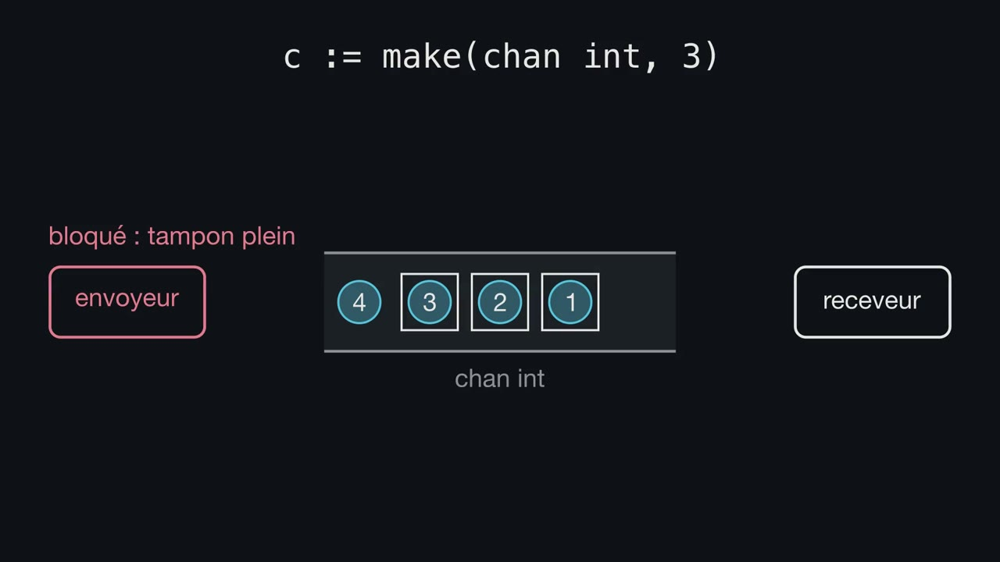

# CM Go : goroutines, channels, select, pipeline

`go`, `sync.WaitGroup`, channels avec ou sans tampon, `close`, `select`, un pipeline, et le deadlock quand on oublie de fermer.

Cours : CM Go. À relier au [TP Go](../tp_go/).
