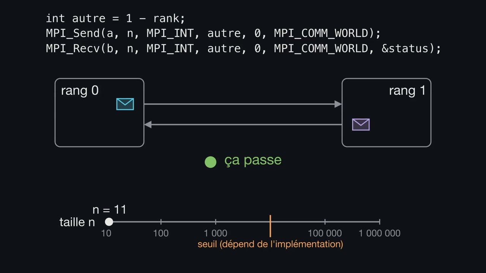

# CM MPI : messages, interblocage et collectives

`MPI_Send` et `MPI_Recv`, interblocage de l'échange symétrique, `MPI_Sendrecv`, communications non bloquantes, Scatter, Reduce, Bcast, coût d'un message.

Cours : CM5 et CM6. À relier aux TP1 et TP2 MPI.
