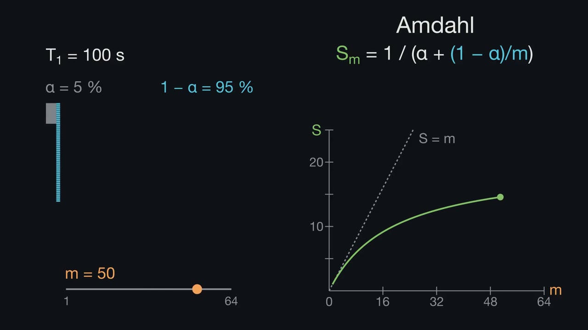

# CM OpenMP et performance

Vidéo : accélération et efficacité, absolue ou relative, lois d'Amdahl et de Gustafson, bornes W/m et chemin critique, bien mesurer. Cours : CM2.

| Diapositives | |
|---|---|
| [cours2-slides.pdf](cours2-slides.pdf) | CM2 : OpenMP et concepts du parallélisme (matériel, Amdahl, Gustafson, compilation, mesure) |
| [openmp-numa-affinity-memoirevirtuelle.pdf](openmp-numa-affinity-memoirevirtuelle.pdf) | CM4 : dépendances de tâches, localité, NUMA, affinité |
