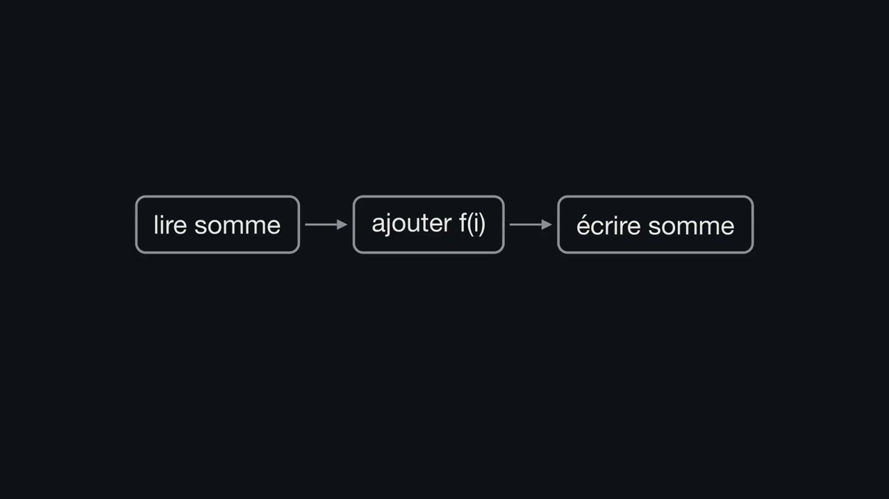

# TP1 OpenMP : les bases

[](video.mp4)

Sujet : `tp1-OMP.pdf` (Ensimag, Algorithmique et Programmation Parallèle, 2026-2027). Les commandes sont dans l'[aide-mémoire](../openmp_aide_memoire.md).
Chaque fichier `.c` contient mon code, avec les explications en commentaire à la fin.

| § | Notion | Fichier |
|---|---|---|
| 2 | `parallel`, boucle partagée à la main, `parallel for` | [hello.c](hello.c), [boucle.c](boucle.c) |
| 3 | `sections` | [sections.c](sections.c) |
| 4 | `atomic` | [atomic.c](atomic.c) |
| 5 | `shared`, `private`, `firstprivate`, `lastprivate` | [partage.c](partage.c) |
| 6 | variables globales : `private` ou `threadprivate` | [globales.c](globales.c) |
| 7 | `critical`, sections critiques nommées | [critical.c](critical.c), [critical_v2.c](critical_v2.c), [critical_v3.c](critical_v3.c) |
| 8 | `reduction`, passage à l'échelle | [reduction.c](reduction.c), [pi.c](pi.c) |
| 9 | syntaxe sans pragma | à faire |
| 10 | produit de matrices | [matrice.c](matrice.c) |

Résultats mesurés sur un Mac 12 cœurs (8 performance + 4 efficacité), avec GCC 15 dans Docker.

---

## §2. Hello World et première boucle

**Chaque thread exécute tout le bloc** : avec 12 threads, `hello.c` affiche 12 lignes, dans un ordre qui change à chaque exécution.

**Partager une boucle à la main** (sans toucher au pragma) : chaque thread démarre à son numéro et avance de `nb`.

```c
int id = omp_get_thread_num(), nb = omp_get_num_threads();
for (int i = id; i < REPS; i += nb) ...
```

Avec 4 threads et `REPS = 10`, l'indice `i` revient au thread `i % nb`. Chaque indice a donc un seul propriétaire :

```
i       : 0 1 2 3 | 4 5 6 7 | 8 9
thread  : 0 1 2 3 | 0 1 2 3 | 0 1
```

**`#pragma omp parallel for`** fait le découpage à ta place, par blocs :

```
thread 0 : 0 1 2   thread 1 : 3 4 5   thread 2 : 6 7   thread 3 : 8 9
```

## §3. sections

```
#pragma omp parallel                 → 8 threads
  #pragma omp sections
    section { f1(); }   → exécutée par un thread (ex. T5)
    section { f2(); }   → par un autre        (ex. T0)
    section { f3(); }   → par un autre        (ex. T2)
                          les 5 autres : rien à faire, ils attendent la barrière
```

Le nombre de sections est fixé dans le code : au-delà de 3 threads, on ne gagne rien. C'est cette limite qui justifie `parallel for`.

## §4. atomic

`sum += x` se fait en 3 étapes : lire, ajouter, écrire. Sans protection :

```
Thread A : lit sum = 100
Thread B : lit sum = 100
Thread A : écrit 105
Thread B : écrit 107      ← le +5 de A est perdu
```

Résultat obtenu : une somme parallèle fausse (par exemple 83 millions au lieu de 499 millions).

`#pragma omp atomic` fait les 3 étapes d'un seul coup : c'est une instruction du processeur, `ldadd` sur ARM et `lock add` sur x86. Le résultat est juste, mais lent, car les threads font la queue devant la même variable.

## §5. Partage de données

Avec 4 threads, et `a = 10`, `b = 20`, `c = 30` au départ :

| Variable | Clause | Dans la région | Après |
|---|---|---|---|
| `a` | `shared` + `atomic` | 11, 12, 13, 14 (une seule `a`) | **14** |
| `b` | `private` | 0 ou 65535 (au hasard) | **20** |
| `c` | `firstprivate` | 31 partout (sa copie de 30, puis +1) | **30** |
| `d = i` | `lastprivate` | — | **7** (dernière itération) |
| `if (i == 0) d = i` | `lastprivate` | — | **au hasard** (la dernière itération n'a rien écrit) |
| `if (i == 0) d = i` | `lastprivate(conditional:d)` | — | **0** |

## §6. Variables globales

```
int n = 10;   (globale)                 private(n)        threadprivate(n)
printf écrit dans la région :           n = id            n = id
imprime() (fonction à part) :           n = 10   ✗        n = id   ✓
```

`private` ne remplace `n` que dans le texte de la région. `threadprivate` donne à chaque thread sa propre copie de la globale, visible partout.

## §7. critical

**7.1. Coût.** 1 million de dépôts, 4 threads : `atomic` 0.029 s, `critical` 0.163 s. Le résultat est le même, mais `critical` est environ 5× plus lent, car il faut prendre et rendre un verrou à chaque dépôt.

**7.2. Garder `x == y`.** Avec deux `atomic` séparés, il existe un instant où `x = y + 1` :

```
Thread A : x++            → x = 1, y = 0
Thread B : if (x != y)    → "Erreur"
Thread A : y++            → x = 1, y = 1
```

Avec un seul `critical` autour de `x++; y++;`, on passe de 220 exécutions sur 300 en erreur à 3 sur 500. Les erreurs restantes viennent de la lecture non protégée dans le `main` : si elle passe aussi par le `critical`, on tombe à 0 sur 500.

**7.3. Noms.** Le thread 0 fait `sleep(1)` et le thread 1 fait `sleep(2)`, chacun dans un `critical` :

| Version | Temps | Pourquoi |
|---|---|---|
| sans nom | 3 s | un seul verrou pour tous : l'un attend l'autre |
| `critical(calc1)` et `critical(calc2)` | **2 s** | deux verrous : les deux `sleep` se font en parallèle |
| même nom pour les deux | 3 s | même nom, donc même verrou |

## §8. reduction et passage à l'échelle

```
reduction(+:sum), 4 threads
thread 0 : sum_0 = tab[0] + … + tab[249999]       ┐
thread 1 : sum_1 = tab[250000] + … + tab[499999]  ├→  sum = sum_0 + sum_1 + sum_2 + sum_3
thread 2 : sum_2 = …                              │
thread 3 : sum_3 = …                              ┘
```

Il n'y a plus de file d'attente pendant la boucle : `atomic` 0.0158 s, `reduction` 0.0001 s.

`pi.c` (100 millions de termes), meilleur temps sur 5 essais :

```
threads   temps     gain
   1      0.161 s   1.0   ██
   2      0.083 s   1.9   ████
   4      0.044 s   3.6   ███████
   8      0.024 s   6.8   ██████████████
  12      0.024 s   6.7   █████████████
  24      0.024 s   6.7   █████████████
```

Le temps baisse presque proportionnellement jusqu'à 8 threads, le nombre de cœurs rapides. Ensuite, plus aucun gain : les 4 cœurs efficacité sont plus lents, et au-delà de 12 threads, il y a plus de threads que de cœurs.

## §9. Sans pragma

À faire.

## §10. Produit de matrices

On parallélise la boucle **extérieure** : chaque thread calcule des lignes entières de `C`, et deux threads n'écrivent jamais dans la même case.

```
           C (62 lignes × 7 colonnes), avec 4 threads
ligne  0   ███████  ┐
  …                 │ thread 0  (lignes 0 à 15)
ligne 15   ███████  ┘
ligne 16   ███████  ┐ thread 1  (lignes 16 à 31)
  …                 ┘
  …                   thread 2, thread 3 : la suite
```

```c
#pragma omp parallel for private(j, k)
for (i = 0; i < NRA; i++)
  for (j = 0; j < NCB; j++)
    for (k = 0; k < NCA; k++)
      c[i][j] += a[i][k] * b[k][j];
```

- `private(j, k)` : `j` et `k` sont déclarés en haut du `main`, donc partagés par défaut. Sans cette clause, le résultat est faux (testé).
- Paralléliser la boucle `k` est faux aussi : tous les threads écrivent dans le même `c[i][j]`.
- Avec cette version, la somme de contrôle vaut 5491185 sur 180 exécutions sur 180.
