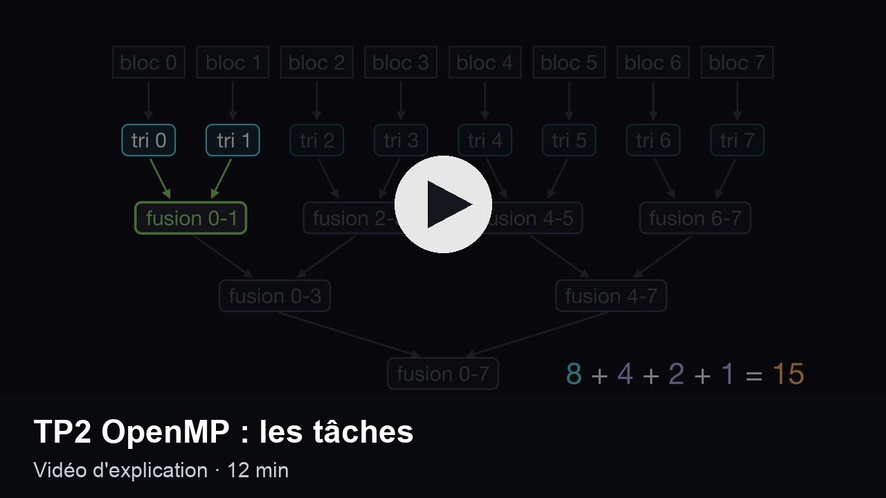

# TP2 OpenMP : les tâches

Sujet : `tp2-OMP-taches.pdf` (Ensimag, Algorithmique et Programmation Parallèle, 2026-2027). Les commandes sont dans l'[aide-mémoire](../openmp_aide_memoire.md).

| Partie | Notion | Réponses | Code |
|---|---|---|---|
| 1 | mise en place, comment mesurer | [question1.txt](question1.txt) | [mesure.sh](mesure.sh) |
| 2 | π avec `taskloop` : `single`, `num_tasks`, `grainsize` | [question2.md](question2.md) | [pi_taches.c](pi_taches.c) |
| 3 | tri par fusion : V1 (`task`, `taskwait`), coût des tâches (`if`, `final`, seuil), V2 (`taskgroup`), V3 (`depend`) | [question3.md](question3.md) | [tri_fusion.c](tri_fusion.c) |

Résultats mesurés sur un Mac 12 cœurs (8 performance + 4 efficacité), avec GCC 15 dans Docker. Questions 3.18 à 3.21 : à faire (la vidéo les traite déjà).
