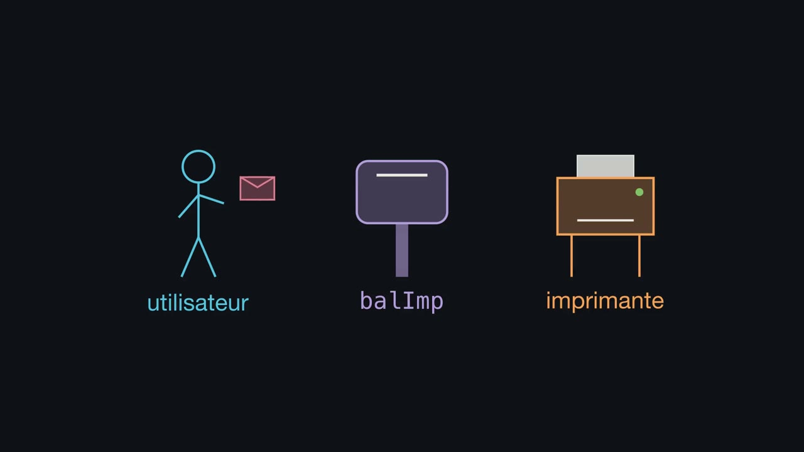

# TP Go : goroutines et channels

Sujet : `tp1-go.pdf` (Ensimag, Algorithmique et Programmation Parallèle, 2026-2027). À faire sur le Mac avec Go 1.25 (`go run fichier.go`) : `w.Go` n'existe pas avant Go 1.25, et le conteneur Docker n'a que Go 1.18.

| Partie | Notion | Réponses | Code |
|---|---|---|---|
| 1 | `go`, fin du `main`, `sync.WaitGroup` | [question1.md](question1.md) | [hello_go.go](hello_go.go) |
| 2 | channels : envoi, lecture, `close`, `range`, sens des flèches | [question2.md](question2.md) | [channels.go](channels.go) |
| 3 | imprimer : rendez-vous, tampon, channel de réponse, serveur avec `select` | [question3.md](question3.md) | [impressions.go](impressions.go) |

État : Q1 à Q8 et 3.5 (serveur avec `select`) faites. 3.5.2 et 3.6 : à faire.
