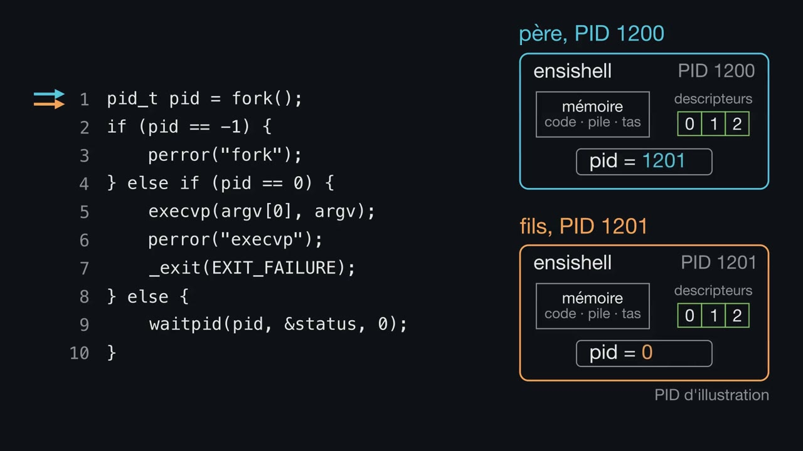

# CM Processus : fork, execvp, waitpid

Comment un shell lance une commande : processus, `fork`, `execvp`, `waitpid`, zombie, boucle de `fork`.

Cours : CM2 (isolation des processus) et CM3. À relier au TP2 Ensishell.
