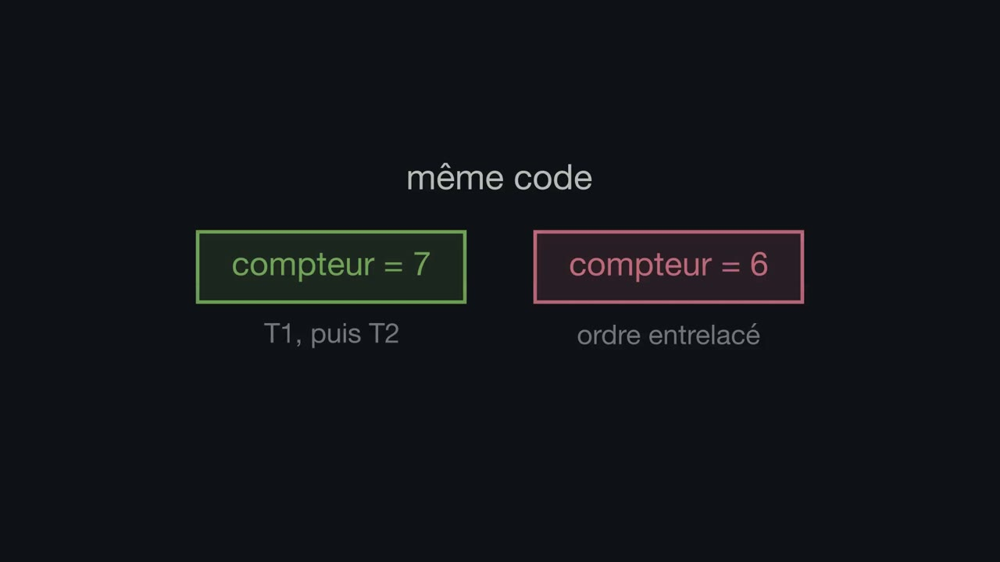

# CM Concurrence : section critique et Peterson

`compteur++` non atomique, les 20 entrelacements, section critique, attente active, Peterson, interblocage, famine, mutex.

Cours : CM3 et CM4. À relier au TP3 (Dekker).
