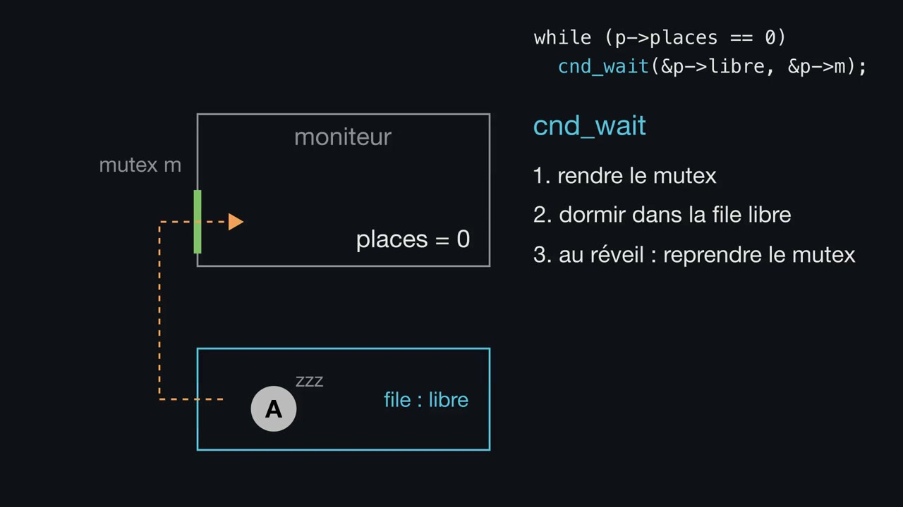

# CM Moniteurs : pourquoi `while` et pas `if`

Mutex et variables de condition, ce que fait `cnd_wait`, signal et broadcast, le scénario du parking, lecteurs-rédacteurs.

Cours : CM4. À relier au [TP RWMutex](../../tp/tp4_moniteur_lecteur_redacteur/).
