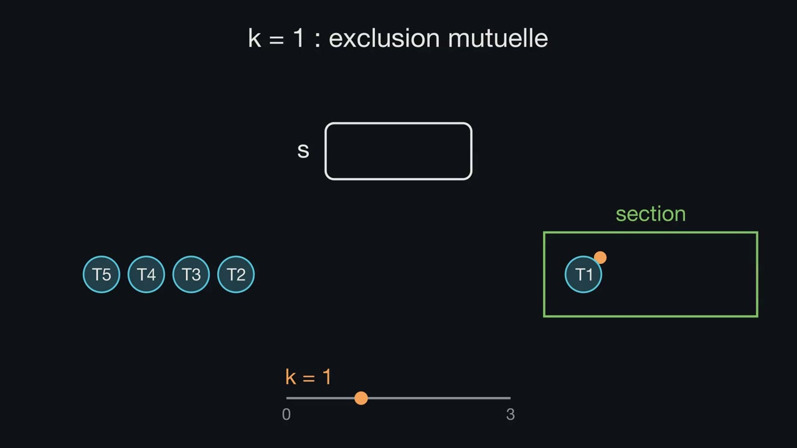

# CM Sémaphores : le tampon borné

P et V, `sem_init`, producteurs-consommateurs avec les sémaphores vides, pleines et mutex, interblocage si l'ordre est inversé, lien avec les channels.

Cours : CM5. À relier au [TP Channel](../../tp/tp5_channel_moniteur/).
