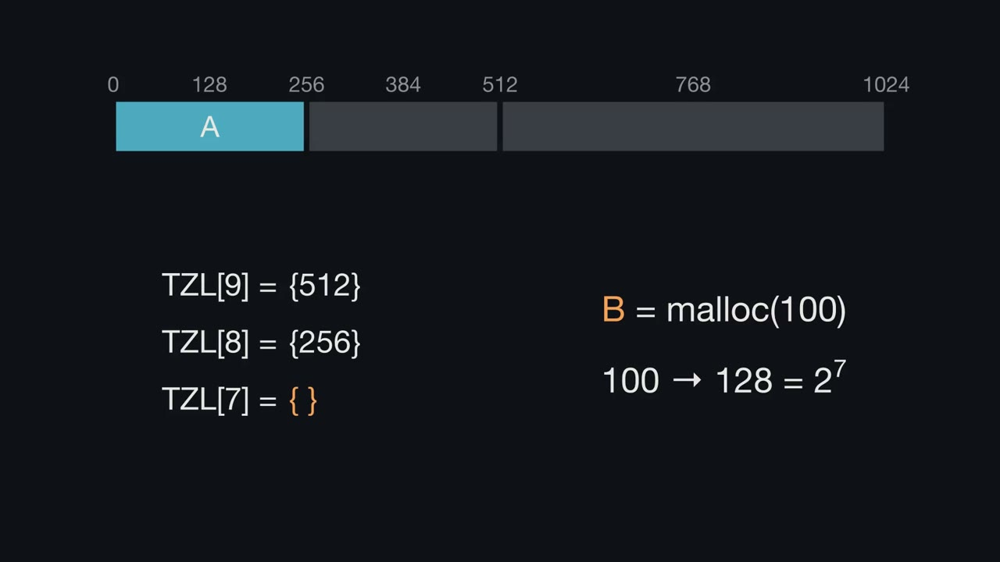

# CM Allocation mémoire : l'allocateur buddy (exercice)

Fragmentation, découpe en compagnons, compagnon = adresse XOR taille, fusion à la libération.

Cours : CM6. À relier au TP6 Allocateur mémoire.
