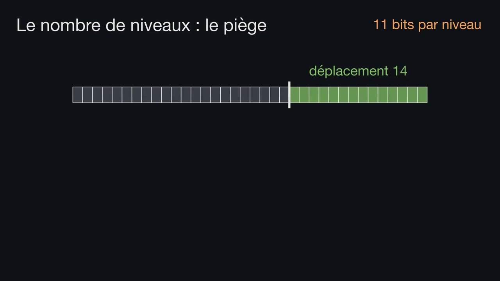

# CM Pagination : de l'adresse virtuelle à l'adresse physique (exercice)

Taille des tables et nombre de niveaux, découpe d'une adresse x86-64, calcul de l'adresse physique, TLB, défaut de page.

Cours : CM7. Exercice dans le style de l'annale de 2013.
