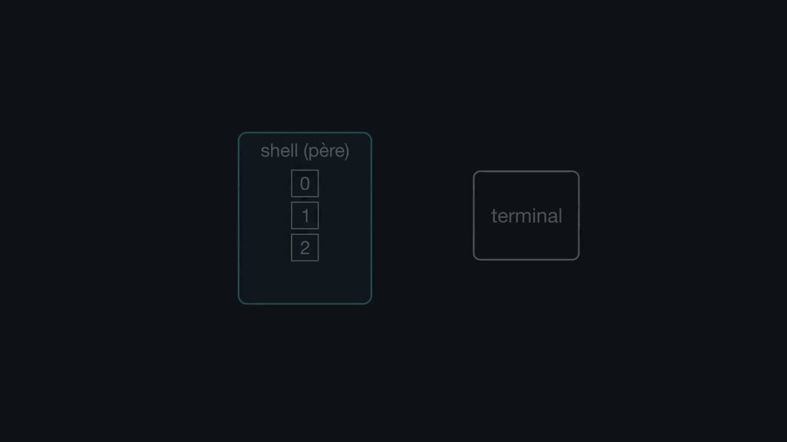

# CM Fichiers : descripteurs, redirection et tube

Table des descripteurs, `open`, `dup2`, `close`, redirection `>`, `pipe`, et pourquoi `wc` attend si une extrémité d'écriture reste ouverte.

Cours : CM8. À relier au TP2 Ensishell (2e partie).
