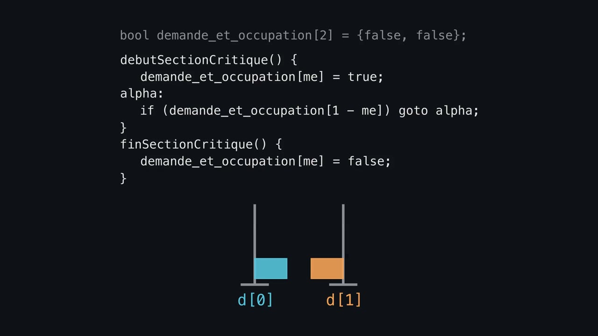

# TP Comprendre la concurrence : les bugs de synchronisation (Dekker)

[](video.mp4)

Sujet : énoncé `dekker.1` (`man -l dekker.1`), indications `dekker.info` (`info -f ./dekker.info`). Cours lié : [CM Concurrence](../../cm/cm03_concurrence/).

**Le but n'est PAS d'écrire un programme correct : c'est de nommer le bug de chaque version.**

## Le programme

Deux threads (`me` = 0 et `me` = 1) font chacun 10 millions de fois :

- `DoubleInc` : `a++; b++;`
- `Check` : `assert(a == b);`

Les deux sont entourés de `debutSectionCritique(me)` et `finSectionCritique(me)`. On ne modifie que ces deux fonctions et des variables globales. **Une version = une copie du squelette.**

## Compiler et lancer

```sh
./tp.sh                  # shell Linux (Docker, GCC 15), dans ce dossier
make                     # compile toutes les versions (Makefile)
time ./v1                # lancer et mesurer
time timeout 10 ./v2     # pour celles qui ne s'arrêtent jamais
make clean               # supprime les exécutables
```

Une version = une copie (`cp synbugs_skel.c v1.c`), ajoutée ensuite à `PROGS` dans le `Makefile`. Avec `make CFLAGS="-Wall -Wextra -g -fanalyzer"`, on ajoute l'analyse statique : ses avertissements « infinite loop » sur les boucles `goto` sont des faux positifs (voir V1).

Boucle d'attente active, écrite avec `goto` (imposé, pour voir qu'une boucle = un test + un saut, deux instructions séparées) :

```c
alpha:
  if (condition_d_attente)
    goto alpha;
```

## Le vocabulaire (dekker.info)

| Propriété | Sens |
|---|---|
| Exclusion mutuelle | au plus un thread à la fois en section critique |
| Sûreté | rien de mauvais n'arrive (l'exclusion mutuelle en est une) |
| Vivacité | ce qu'on attend finit par arriver |
| Famine | **un** thread attend pour toujours |
| Interblocage | **tous** les threads attendent pour toujours |

## Piège du sujet : `bool` ou `atomic_bool` ?

Les titres du sujet disent « variables booléennes **atomiques** », mais le code donné déclare `static bool`. Il faut **`atomic_bool`**. Avec un simple `bool`, mesuré sur Mac (ARM) en V5.5 : `Aborted` tout de suite. Avec `atomic_bool` : ça marche en 0,1 s.

Pourquoi : chaque thread **écrit** son drapeau, puis **lit** celui de l'autre. Avec `bool`, le processeur peut faire la lecture avant que l'écriture soit visible par l'autre cœur (elle attend dans un tampon du cœur) :

```
T0 : drapeau[0] = true    (pas encore visible par T1)
T1 : drapeau[1] = true    (pas encore visible par T0)
T0 : lit drapeau[1] → false → entre
T1 : lit drapeau[0] → false → entre      → deux dedans ✗
```

> `atomic_bool` interdit ce **réordonnancement mémoire** : l'écriture est visible par tous avant la lecture qui suit. Sans lui, les algorithmes à drapeaux (V5.5, Dekker, Peterson) sont faux sur un vrai processeur.

## Avancement

| Version | Fichier | Ce qui se passe | Classe du bug |
|---|---|---|---|
| Prérequis | `synbugs_skel.c` | `Assertion a == b failed` dans `Check`, tout de suite | exclusion mutuelle violée (sûreté) |
| 0 : `a` et `b` atomiques | `v0.c` | pareil : `Assertion a == b failed` dans `Check` | exclusion mutuelle violée (sûreté) |
| 1 : booléen `occupation` | `v1.c` | `Assertion a == b failed` | exclusion mutuelle violée (sûreté) |
| 2 : `occupation` avant la boucle | `v2.c` | ne plante pas, ne finit jamais, 2 cœurs à 100 % | interblocage (vivacité KO, sûreté OK) |
| 3 : `tour` | `v3.c` | 2 threads : marche (1,5 s) ; 1 seul thread : bloqué pour toujours | famine (alternance stricte) |
| 4 : `demande_et_occupation[2]` | `v4.c` | ne finit jamais, 2 cœurs à 100 % | interblocage (chacun attend l'autre) |
| 5 : renoncement | `v5.c` | finit (0,7 s, 2 cœurs à 100 %) : le bug ne se voit pas | vivacité non garantie : interblocage actif (*livelock*) possible |
| 5.5 : renoncement + attente aléatoire | `v55.c` | marche : 0,11 s | pas de bug (mais des inconvénients) |
| 6 : renonce si ce n'est pas son tour | `v6.c` | finit, mais très lent : 16,7 s (V5 : 0,7 s), 2 cœurs à 100 % | vivacité non garantie : celui qui a le tour peut ne jamais entrer |
| Dekker | `dekker.c` | marche : 0,52 s (V6 : 16,7 s) | correct : sûreté, vivacité, pas de famine |
| Peterson | `peterson.c` | marche : 1,8 s | correct : sûreté, vivacité, pas de famine |
| Mutex | `v_mutex.c` | marche : 0,95 s, `sys` 0,54 s | correct, sans attente active |
| RWMutex | `v_rwmutex.c` | marche : 28 s, `user` 4 min (12 threads) | correct, mais famine des écrivains (priorité aux lecteurs) |
| Spinlock | `spinlock.c` | marche : 0,5 s, `sys` 0 s | correct, en attente active |

---

## Prérequis : le squelette sans protection

`debutSectionCritique` et `finSectionCritique` sont vides : rien n'empêche `Check` de lire pendant un `DoubleInc`.

```
          T0          T1               a   b
départ                                 0   0
          a++                          1   0
                      a++ ; b++        2   1
                      Check : 2 ≠ 1 ✗
          b++                          2   2
```

Un thread fait toujours son `DoubleInc` avant son `Check`, mais l'autre thread peut être **entre** `a++` et `b++` à ce moment-là.

- L'erreur vient de la ligne 24 (`Check`, pendant l'exécution), pas des `assert` du `main` après le `join`.
- En plus, `a++` = lire, ajouter, écrire : deux `a++` simultanés peuvent en perdre un.

> **Exclusion mutuelle violée** : deux threads en section critique en même temps. C'est une propriété de **sûreté**.

## Version 0 : une paire de variables atomiques n'est pas atomique

```c
static atomic_int a = 0;
static atomic_int b = 0;
```

- `atomic_int` rend **chaque** `a++` indivisible : plus d'incrémentation perdue.
- Mais pas la **paire** `a++; b++` : `Check` peut toujours lire entre les deux (même scénario que le prérequis).

> Rendre chaque variable atomique ne protège pas un groupe d'opérations. Il faut une **section critique** autour du groupe.

## Version 1 : attendre que ce soit libre, puis prendre

```c
static bool occupation = false;

void debutSectionCritique(int me) {
alpha:
  if (occupation)          // occupé : on attend
    goto alpha;
  occupation = true;       // libre : on prend
}
void finSectionCritique(int me) { occupation = false; }
```

Le **test** et la **prise** sont deux étapes séparées : les deux threads peuvent voir « libre » avant que l'un d'eux écrive `true`.

```
          T0                        T1                        occupation
          if (occupation) → libre                             false
                                    if (occupation) → libre   false
          occupation = true                                   true
                                    occupation = true         true
          les deux sont dans la section critique → Check voit a ≠ b ✗
```

> Tester puis prendre doit se faire en **une seule opération indivisible** (c'est ce que fait un spinlock).

**L'avertissement `-fanalyzer` « infinite loop »** : l'analyseur regarde la fonction seule et ne sait pas qu'un autre thread modifie `occupation`. Faux positif ici, mais avec un simple `bool`, le compilateur en `-O2` aurait le droit de ne lire la variable qu'une fois (boucle vraiment infinie).

## Version 2 : prendre avant d'attendre

```c
void debutSectionCritique(int me) {
  occupation = true;       // il occupe…
alpha:
  if (occupation)          // …donc c'est vrai…
    goto alpha;            // …et il reboucle pour toujours
}
```

Mesuré : `time timeout 5 ./v2` → `real 5 s`, `user 10 s`. Deux cœurs à 100 %, et rien n'avance.

- Chaque thread **s'attend lui-même** : seul `finSectionCritique` remet `false`, mais il est après la section critique, et le thread est bloqué avant.
- **Interblocage** : tous les threads attendent pour toujours.
- En attente **active**, un interblocage consomme 100 % de CPU (avec `cnd_wait`, il dort : 0 %).

> La sûreté est respectée (personne n'entre, donc rien n'est cassé), mais pas la **vivacité** (rien n'avance). Un programme qui ne fait rien est « sûr » : la sûreté seule ne suffit pas.

## Version 3 : un tour, qu'on se passe

`tour` = le numéro du thread qui a le droit d'entrer. En sortant, il donne le tour à l'autre.

```c
static atomic_int tour = 0;

void debutSectionCritique(int me) {
alpha:
  if (me != tour)          // pas mon tour : j'attends
    goto alpha;
}
void finSectionCritique(int me) { tour = 1 - me; }   // je donne le tour à l'autre
```

| Test | Mesuré |
|---|---|
| a) 2 threads | marche : `real 1,5 s`, `user 3 s` (l'autre thread tourne dans sa boucle pendant ce temps) |
| b) 1 seul thread (création et `join` de `t2` en commentaire) | ne finit jamais : `real 5 s`, `user 5 s` (1 cœur à 100 %) |

Pourquoi b) bloque :

```
T0 : DoubleInc   → entre (tour = 0), puis tour = 1
T0 : Check       → tour = 1 ≠ 0 : attend… que T1 rende le tour. T1 n'existe pas : pour toujours.
```

- **Famine** : **un** thread attend pour toujours, alors que personne ne l'attend en retour (ce n'est pas un interblocage).
- Le vrai défaut : l'**alternance stricte** (T0, T1, T0, T1…). Un thread ne peut pas entrer deux fois de suite, même si l'autre ne demande rien. Avec 2 threads, ça marche seulement parce que les deux font exactement le même nombre de passages.

> Un thread **qui ne demande pas** la section critique ne doit jamais bloquer l'autre. La V3 a la sûreté, pas la vivacité.

## Version 4 : deux drapeaux

Chaque thread lève son drapeau (« je veux entrer »), puis attend que l'autre ait baissé le sien.

```c
static atomic_bool demande_et_occupation[2] = {};   // le titre du sujet dit « atomiques »

void debutSectionCritique(int me) {
  demande_et_occupation[me] = true;          // je lève mon drapeau
alpha:
  if (demande_et_occupation[1 - me])         // l'autre a levé le sien : j'attends
    goto alpha;
}
void finSectionCritique(int me) { demande_et_occupation[me] = false; }
```

Mesuré : ne finit jamais, 2 cœurs à 100 % (`user` = 2 × `real`).

```
T0 : drapeau[0] = true
T1 : drapeau[1] = true
T0 : drapeau[1] levé → attend que T1 le baisse
T1 : drapeau[0] levé → attend que T0 le baisse      → pour toujours
```

- On ne baisse son drapeau qu'en **sortant**, et aucun n'entre.
- **Interblocage** : tous attendent, et chacun attend **l'autre** (en V2, chacun s'attendait lui-même).

> Sûreté OK (jamais deux dedans), vivacité KO. Il faut un moyen de **céder** : c'est la V5.

## Version 5 : renoncer pendant l'attente

```c
static atomic_bool demande_et_occupation[2] = {};

void debutSectionCritique(int me) {
alpha:
  demande_et_occupation[me] = true;          // je lève mon drapeau
  if (demande_et_occupation[1 - me]) {       // l'autre le veut aussi :
    demande_et_occupation[me] = false;       //   je renonce (je baisse le mien)
    goto alpha;                              //   et je réessaie
  }
}
```

Mesuré : finit, `real 0,7 s`, `user 1,4 s`. Le bug est « subtil » : on ne le voit pas en lançant le programme.

```
T0 : lève         T1 : lève
T0 : voit T1      T1 : voit T0
T0 : baisse       T1 : baisse
T0 : relève       T1 : relève      → et ainsi de suite, pour toujours
```

- Si les deux restent parfaitement synchronisés, chacun cède à l'autre sans fin. Personne n'entre, alors que les deux tournent à 100 %. C'est un **interblocage actif** (*livelock*), comme deux personnes qui s'écartent du même côté dans un couloir.
- En pratique, ils finissent par se décaler (planificateur, caches), donc le programme termine. Mais rien ne le **garantit**.

> Sûreté OK (on n'entre que si l'autre a baissé son drapeau). Vivacité **non garantie** : le bug est possible, même s'il est rare.

## Version 5.5 : renoncer, puis attendre un temps aléatoire

```c
  if (demande_et_occupation[1 - me]) {
    demande_et_occupation[me] = false;
    usleep(drand48() * 10);                  // attente aléatoire (0 à 10 µs)
    goto alpha;
  }
```

Mesuré : `real 0,11 s` (avec `bool` au lieu de `atomic_bool` : `Aborted`, voir le piège plus haut).

- Le bug de la V5 vient de la **symétrie** : les deux font la même chose au même moment.
- Le hasard casse la symétrie : chacun attend un temps différent. Celui qui revient en premier trouve le drapeau de l'autre baissé, et il entre.
- Le drapeau reste baissé **pendant tout le `usleep`** : c'est ce temps qui laisse passer l'autre. En V5, il n'est baissé que le temps d'une instruction (entre `= false` et le `= true` d'après `alpha`), donc l'autre doit tomber pile dans ce trou.
- Plus rapide que la V5 : pendant qu'un thread dort, l'autre enchaîne ses passages sans être gêné.

Pas de bug, mais des **inconvénients** :

- **probabiliste** : il est très probable qu'un thread finisse par entrer, mais ce n'est pas garanti ;
- **pas équitable** : un thread peut gagner plusieurs fois de suite, l'ordre d'arrivée ne compte pas ;
- **attente active** : hors du `usleep`, le cœur tourne pour rien ;
- **durée à régler** : trop courte, les deux se recroisent ; trop longue, on dort pour rien.

## Version 6 : seul celui dont ce n'est pas le tour renonce

Au lieu du hasard (5.5), un **tour** décide qui cède.

```c
static atomic_bool demande_et_occupation[2] = {};
static atomic_int tour = 0;

void debutSectionCritique(int me) {
alpha:
  demande_et_occupation[me] = true;
  if (demande_et_occupation[1 - me]) {
    if (tour != me)                          // pas mon tour :
      demande_et_occupation[me] = false;     //   je renonce
    goto alpha;                              // les deux rebouclent
  }
}
void finSectionCritique(int me) {
  tour = 1 - me;                             // je donne le tour à l'autre
  demande_et_occupation[me] = false;
}
```

Mesuré : `real 16,7 s`, `user 33,4 s`. Ça finit, mais 20 fois plus lentement que la V5 (0,7 s), avec 2 cœurs à 100 %.

Pourquoi : celui qui renonce **relève son drapeau tout de suite** (`goto alpha`, puis `= true`). Son drapeau n'est baissé que le temps d'une instruction.

```
tour = 0, les deux veulent entrer
T0 (a le tour)    : garde son drapeau levé, attend de voir drapeau[1] à false
T1 (pas son tour) : baisse, relève, baisse, relève…   (trou d'une instruction)
T0                : doit lire drapeau[1] pile dans le trou → rare → très lent
```

- T1 ne peut pas entrer non plus, car le drapeau de T0 reste levé. Si T0 ne tombe jamais dans le trou, **personne** n'avance.
- **Bug de vivacité** : rien ne garantit que celui qui a le tour entre un jour. Celui qui renonce gêne justement celui qu'il devait laisser passer.

> Renoncer ne suffit pas : il faut **rester en retrait** (drapeau baissé) jusqu'à ce que ce soit son tour. C'est ce qu'ajoute Dekker.

## Dekker (1966) : renoncer, et rester en retrait jusqu'à son tour

V6 + 2 petites boucles : celui qui renonce **garde son drapeau baissé** jusqu'à ce que ce soit son tour.

```c
static atomic_bool demande_et_occupation[2] = {};
static atomic_int tour = 0;

void debutSectionCritique(int me) {
alpha:
  demande_et_occupation[me] = true;
beta:
  if (demande_et_occupation[1 - me]) {       // l'autre veut entrer
    if (tour != me) {                        // pas mon tour :
      demande_et_occupation[me] = false;     //   je renonce
    gamma:
      if (tour != me)                        //   j'attends mon tour, drapeau baissé
        goto gamma;
      goto alpha;                            //   puis je recommence
    }
    goto beta;                               // mon tour : j'attends que l'autre renonce
  }
}                                            // l'autre ne demande rien : j'entre
void finSectionCritique(int me) {
  tour = 1 - me;
  demande_et_occupation[me] = false;
}
```

Mesuré : `real 0,52 s`, `user 1,03 s` (V6 : 16,7 s). Ça marche.

| Boucle | Qui | Attend quoi |
|---|---|---|
| `alpha` | celui qui a renoncé | recommence tout, une fois son tour venu |
| `beta` | celui qui a le tour | que l'autre baisse son drapeau |
| `gamma` | celui qui n'a pas le tour | drapeau baissé, que le tour lui revienne |

- **Pourquoi ça corrige la V6** : pendant `gamma`, le drapeau de celui qui renonce reste baissé. Celui qui a le tour le voit donc forcément, et il entre. Le tour ne change qu'à sa sortie : celui qui renonce ne relève son drapeau qu'une fois l'autre passé.
- **Pas de famine** : en sortant, on donne le tour à l'autre. En cas de conflit, c'est donc l'autre qui gagne la fois suivante. Chacun attend au plus un passage de l'autre.
- **Pas d'alternance stricte** (contrairement à la V3) : si l'autre ne demande rien (drapeau baissé), on entre tout de suite, même si ce n'est pas notre tour. Le tour ne sert qu'à **départager** quand les deux veulent entrer.
- **Et `goto alpha` à la place de `goto beta` ?** Ça marche aussi. Celui qui a le tour réécrit `true` dans son drapeau, déjà à `true`, ce qui ne change rien. C'est alors exactement « V6 + `gamma` ». Mais cela fait une écriture inutile à chaque passage : un peu plus lent (mesuré : 0,52 s contre 0,44 s), et ce n'est pas les 3 boucles demandées.

> Dekker = drapeaux (sûreté) + tour (vivacité, pas de famine). Défauts : attente active, 2 threads seulement, 3 boucles, et `atomic_bool` obligatoire.

## Peterson (1981) : le dernier arrivé attend

Une seule boucle. À la place de `tour`, une variable `dernier`.

```c
static atomic_bool demande_et_occupation[2] = {};
static atomic_int dernier = 0;

void debutSectionCritique(int me) {
  demande_et_occupation[me] = true;          // je veux entrer
  dernier = me;                              // je suis arrivé en dernier
alpha:
  if (demande_et_occupation[1 - me] && dernier == me)   // l'autre veut entrer ET je suis le dernier
    goto alpha;                                          // → j'attends
}
void finSectionCritique(int me) { demande_et_occupation[me] = false; }
```

Mesuré : `real 1,8 s`, `user 3,6 s`. Ça marche (plus lent que Dekker ici).

Erreur faite : `dernier != me` → `Assertion a == b failed`. Celui qui vient d'arriver passe toujours, même si l'autre est déjà dedans.

**Si les deux arrivent en même temps** : les deux écrivent `dernier`, et c'est la **dernière écriture qui reste**. Ce thread-là attend, l'autre entre.

```
T0 : drapeau[0] = true            T1 : drapeau[1] = true
T0 : dernier = 0
                                  T1 : dernier = 1          ← écrit en dernier
T0 : drapeau[1] && dernier == 0 ? non → entre
                                  T1 : drapeau[0] && dernier == 1 ? oui → attend
```

- **Pas d'interblocage** : `dernier` n'a qu'une valeur, donc un seul des deux peut attendre.
- **Pas de famine** : celui qui attend est libéré dès que l'autre sort (drapeau baissé). Si l'autre revient tout de suite, il écrit `dernier` = lui-même, et c'est donc lui qui attend : il ne peut pas doubler deux fois.

> Peterson = drapeaux (sûreté) + `dernier` (départage, pas de famine), en une seule boucle. Mêmes défauts que Dekker : attente active, 2 threads seulement, `atomic_bool` obligatoire.

## Mutex : sans attente active

On repart du squelette : plus de drapeaux ni de `goto`, on prend le verrou de la bibliothèque.

```c
static mtx_t m;

void debutSectionCritique(int me) { mtx_lock(&m); }
void finSectionCritique(int me)   { mtx_unlock(&m); }

// main, avant les thrd_create : mtx_init(&m, mtx_plain);
// main, après les thrd_join   : mtx_destroy(&m);
```

Mesuré : `real 0,95 s`, `user 1,35 s`, `sys 0,54 s`.

- Un thread qui ne peut pas prendre le verrou demande au noyau de l'**endormir**. `mtx_unlock` le réveille. Pendant qu'il dort, il ne consomme pas de CPU : c'est ça, « **sans attente active** ».
- On le voit au `sys` : 0,54 s dans le noyau pour endormir et réveiller. Les versions à `goto` restaient à `sys` ≈ 0,002 s.
- Dekker (0,52 s) est plus rapide **ici** : la section critique est minuscule, donc chaque attente est très courte, et aller dormir coûte plus cher que tourner un instant.
- Le mutex gagne quand l'attente est **longue**, ou quand il y a **plus de threads que de cœurs** : un thread qui tourne en boucle occupe le cœur dont le détenteur du verrou aurait besoin.

> En vrai, on utilise le mutex : correct, N threads, pas besoin d'`atomic_bool` (le verrou s'occupe de l'ordre des accès mémoire), 0 % de CPU pendant l'attente.

## RWMutex : plusieurs lecteurs en même temps

`Check` ne fait que **lire** : plusieurs `Check` peuvent être dedans ensemble. `DoubleInc` **écrit** : il doit être seul.

```c
#include <pthread.h>
static pthread_rwlock_t rw;

void debutSectionCritique(int me) { pthread_rwlock_wrlock(&rw); }  // DoubleInc : écriture
void finSectionCritique(int me)   { pthread_rwlock_unlock(&rw); }  // un seul unlock pour les deux

void Check(int me) {
  pthread_rwlock_rdlock(&rw);                // lecture, à la place de debutSectionCritique
  assert(a == b);
  finSectionCritique(me);
}

int ManyChecks(void *arg) {                  // les 10 lecteurs : seulement des Check
  int me = (long int)arg;
  for (uint64_t i = 0; i < NB; i++)
    Check(me);
  return 0;
}

int main() {
  thrd_t t1, t2, lecteurs[10];
  pthread_rwlock_init(&rw, nullptr);
  thrd_create(&t1, ManyTimes, (void *)0);
  thrd_create(&t2, ManyTimes, (void *)1);
  for (long i = 0; i < 10; i++)
    thrd_create(&lecteurs[i], ManyChecks, (void *)i);
  thrd_join(t1, nullptr);
  thrd_join(t2, nullptr);
  for (int i = 0; i < 10; i++)
    thrd_join(lecteurs[i], nullptr);
  pthread_rwlock_destroy(&rw);
  assert(a == 2 * NB);
  assert(b == 2 * NB);
}
```

| Verrou | Peut être dedans avec… |
|---|---|
| `wrlock` (écrivain) | personne |
| `rdlock` (lecteur) | d'autres lecteurs, jamais un écrivain |

Mesuré : `real 28 s`, `user 4 min 4 s` (≈ 9 cœurs occupés), `sys 2,5 s`.

- Lire en même temps ne casse rien (`a` et `b` ne bougent pas). Écrire doit se faire seul : un lecteur au milieu verrait `a ≠ b`, et deux écrivains perdraient des incréments.
- **Lent** : 12 threads et 120 millions de `Check`. Et un `rdlock` n'est pas gratuit : chaque lecteur modifie le compteur de lecteurs du verrou, donc tous les cœurs se disputent la même case mémoire.
- **Famine des écrivains** : le verrou POSIX par défaut donne la priorité aux lecteurs. Tant qu'un lecteur est dedans, les nouveaux entrent, et l'écrivain attend. Mesuré en datant la fin de chaque thread : les 10 lecteurs finissent vers 24 s, les 2 écrivains à 26 s, **après tous les lecteurs** (seuls, ils mettaient 0,95 s en version mutex).

> Correction : priorité aux écrivains (`PTHREAD_RWLOCK_PREFER_WRITER_NONRECURSIVE_NP`), voir le [TP RWMutex](../tp4_moniteur_lecteur_redacteur/).

Erreurs faites, à retenir :

- `rdlock` **en plus** de `debutSectionCritique` dans `Check` : le lecteur demande ensuite l'écriture, qui attend que tous les lecteurs sortent… y compris lui. Il est bloqué pour toujours (il s'attend lui-même, comme en V2).
- `thrd_create(&t, …)` prend l'**adresse** (elle remplit `t`) ; `thrd_join(t, …)` prend la **valeur** (elle lit `t`).
- Ordre du `main` : tout créer, **puis** tout attendre (`join`), **puis** `destroy` et les `assert`. Faire les `join` des lecteurs avant de créer les écrivains les fait tourner chacun de leur côté : plus de concurrence, donc plus rien à tester.
- Il n'y a qu'**un** `pthread_rwlock_unlock`, pour la lecture comme pour l'écriture.

## Spinlock : l'attente active bien faite

```c
#include <pthread.h>
static pthread_spinlock_t s;

void debutSectionCritique(int me) { pthread_spin_lock(&s); }
void finSectionCritique(int me)   { pthread_spin_unlock(&s); }

// main, avant les thrd_create : pthread_spin_init(&s, PTHREAD_PROCESS_PRIVATE);
// main, après les thrd_join   : pthread_spin_destroy(&s);
```

`PTHREAD_PROCESS_PRIVATE` : le verrou est partagé entre les threads d'un seul processus.

Mesuré avec les 2 threads du sujet : `real 0,5 s`, `user 1 s`, `sys 0,000 s`.

- `pthread_spin_lock` fait « tester si c'est libre **et** prendre » en **une seule opération indivisible**. C'est exactement ce qui manquait à la V1.
- **`sys` = 0** : le thread qui attend ne va jamais dans le noyau, il **tourne** sur le verrou (`user` = 2 × `real`). Le mutex, lui, va dormir (`sys` 0,54 s).
- Aussi rapide que Dekker, mais pour N threads et sans le piège `atomic_bool`.
- Premier essai avec les 12 threads du RWMutex (copié depuis `v_rwmutex.c`) : `real 14 s`, `user 2 min 43 s`. Environ 11,5 cœurs à 100 % : **chaque thread qui attend brûle un cœur**.

> Spinlock si la section critique est **très courte** et qu'il n'y a **pas plus de threads que de cœurs** (attendre coûte moins cher que dormir puis se réveiller). Sinon, mutex.

## Bilan

| Version | Sûreté | Vivacité | Défaut |
|---|---|---|---|
| V0, V1 | ✗ | | test puis prise en deux étapes |
| V2 | ✓ | ✗ interblocage | s'attend lui-même |
| V3 | ✓ | ✗ famine | alternance stricte |
| V4 | ✓ | ✗ interblocage | chacun garde son drapeau levé en attendant |
| V5 | ✓ | pas garantie (livelock) | les deux cèdent en même temps |
| V5.5 | ✓ | probable | hasard, pas équitable |
| V6 | ✓ | pas garantie, très lent | celui qui cède relève son drapeau tout de suite |
| Dekker, Peterson | ✓ | ✓ | 2 threads, attente active, `atomic_bool` obligatoire |
| Mutex | ✓ | ✓ | dort quand il attend (`sys`) |
| RWMutex | ✓ | famine des écrivains | priorité aux lecteurs par défaut |
| Spinlock | ✓ | ✓ | attente active : brûle un cœur par thread qui attend |
