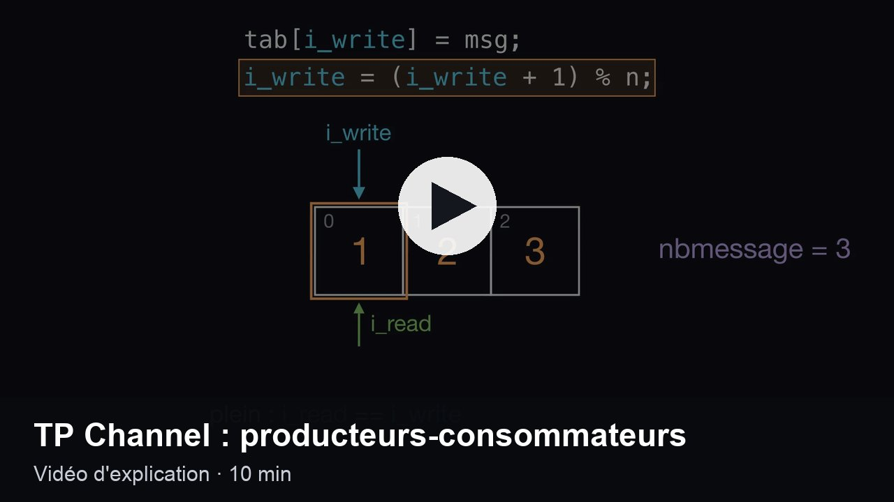

# TP Channel : producteurs-consommateurs, en moniteur puis en sémaphores

[](video.mp4)

Sujet : [sujet_tp_channel.pdf](sujet_tp_channel.pdf) (énoncé `channel.1`, indications `channel.info`). Les commandes sont dans l'[aide-mémoire](../../synchro_aide_memoire.md).

| Version | Fichiers |
|---|---|
| 1. Moniteur : 1 mutex + 1 condition | [channel_moniteur.h](channel_moniteur.h), [channel_moniteur.c](channel_moniteur.c), [mesure_perf_channel_moniteur.c](mesure_perf_channel_moniteur.c) |
| 2. Sémaphores : 2 mutex + 2 sémaphores | [channel_sem.h](channel_sem.h), [channel_sem.c](channel_sem.c), [mesure_perf_channel_sem.c](mesure_perf_channel_sem.c) |
| Test de l'ordre FIFO des deux versions | [test_fifo.c](test_fifo.c) |

Fiche « et si on me demande pourquoi ? » : chaque choix du code, avec sa raison.

## Le TP en bref
- **Channel** : une file FIFO de capacité fixe `n`, partagée entre threads.
- **Producteurs** : appellent `add`, déposent un message et **dorment si c'est plein**.
- **Consommateurs** : appellent `pop`, retirent un message et **dorment si c'est vide**.
- Le squelette lance 4 producteurs et 4 consommateurs sur un tampon de 3 cases (`NBTH - 1`), avec 1 000 000 de messages chacun.
- Deux versions à écrire : **moniteur** (1 mutex + condition) puis **sémaphores** (2 mutex + 2 sémaphores, aucune condition).
- But secondaire : comparer les performances.

---

## Tampon circulaire et structure (commun aux deux versions)

**Pourquoi `i_write++` puis `i_write % n` ?**
C'est un tampon circulaire (`channel.info` 1.2). Arrivé après la dernière case, l'indice revient à 0. Sans le modulo, on écrirait en dehors du tableau, ce qui donne un `Segmentation fault`.

**Pourquoi on ne décrémente jamais `i_read` ni `i_write` ?**
Ce sont des **positions** (où lire, où écrire), pas des compteurs : elles ne font qu'avancer en tournant. Ce qui monte et descend, c'est le **nombre de messages** : `nbmessage` dans le moniteur, les sémaphores dans l'autre version.

**Quand une case lue devient-elle libre ?**
Dès que `i_read` la dépasse. On ne l'efface pas : une case est libre par sa **position** (hors de la zone entre `i_read` et `i_write`), pas par son contenu. Un prochain `add` écrira par-dessus.

**Pourquoi un compteur `nbmessage` ?**
Avec les seuls indices, on ne distingue pas un tampon **plein** d'un tampon **vide** : dans les deux cas, `i_read == i_write` (`channel.info` 1.2).

**Pourquoi `tab[]` sans taille, en dernier champ ?**
La taille d'une structure doit être connue à la compilation, alors que `n` n'est connu qu'à l'exécution. Un tableau sans taille en dernier champ se place juste après la structure en mémoire (`channel.info` 1.1).

**Le `malloc` :** `malloc(sizeof(channel_moniteur_t) + n * sizeof(unsigned int))`
- `sizeof(struct)` : tous les champs fixes (mutex, condition, compteurs). `tab[]` compte pour 0.
- `n * sizeof(unsigned int)` : les n cases du tampon.
- C'est un seul bloc, donc **un seul `free`**. On utilise `malloc` parce que le channel doit survivre à la fonction et être partagé par tous les threads.

**Pourquoi mettre tous les champs à 0 dans `new` ?**
`malloc` ne met pas la mémoire à zéro : elle contient n'importe quoi.

**Pourquoi copier le message dans `msg` avant le `unlock`, dans `pop` ?**
Après l'unlock, un producteur peut réécrire la case. On renverrait alors le mauvais message.

---

## Version 1 : le moniteur

```c
mtx_lock(&c->mutex);
c->nb_block_write++;
while (c->n == c->nbmessage)            // plein : on attend
    cnd_wait(&c->cond, &c->mutex);
c->nb_block_write--;
/* écrire, avancer i_write modulo n, nbmessage++ */
if (c->nb_block_read > 0) cnd_broadcast(&c->cond);
mtx_unlock(&c->mutex);
```

**Un moniteur, c'est quoi ?**
Des données plus des fonctions qui les manipulent **toutes sous le même mutex**. Lock au début, unlock à la fin, dans TOUTES les fonctions (`rwmutex.info` 1.4.1).

**Que fait `cnd_wait(&cond, &mutex)` ?**
Il relâche le mutex et endort le thread, de façon atomique. Au réveil, il reprend le mutex avant de rendre la main. S'il ne relâchait pas le mutex, personne ne pourrait faire `pop` pour libérer une place.

**Pourquoi `while` et pas `if` ?**
Être réveillé ne donne pas la priorité : un autre thread peut passer avant et rendre la condition de nouveau fausse. Il faut donc **revérifier** (`rwmutex.info` 1.4.2). Testé : avec `if`, le tampon déborde à chaque exécution.

**Pourquoi une seule condition ?**
Le sujet dit « (mutex, condition) », au singulier. Quand le prof veut deux exemplaires, il l'écrit, par exemple « les deux mutex, les deux sémaphores ».

**Pourquoi `cnd_broadcast` et pas `cnd_signal` ?**
Producteurs et consommateurs dorment sur la **même** condition. `signal` en réveille **un seul**, peut-être du mauvais type : le signal utile est perdu et tout le monde dort. Testé : **interblocage** (0 % de CPU). `broadcast` réveille tout le monde, chacun revérifie son `while`, et celui qui peut avancer avance.
(Avec 2 conditions, une pour chaque côté, `signal` suffirait.)

**À quoi servent `nb_block_read` et `nb_block_write` ?**
C'est demandé par le sujet. On ne réveille que si quelqu'un dort vraiment. Chaque fonction gère **son** compteur (`add` gère `nb_block_write`) et **lit** celui de l'autre pour décider s'il faut réveiller.

**Pourquoi `++` avant le `while` et `--` après ?**
Pour qu'ils s'exécutent **exactement une fois chacun**. Si le `--` est hors du `while` alors que le `++` est dedans, le compteur se décale. En `unsigned`, 0 − 1 donne 4294967295.

---

## Version 2 : mutex + sémaphores

```c
sem_wait(&c->case_libres);      // libres -1 (dort si plein)
mtx_lock(&c->mutex_write);
/* écrire, avancer i_write modulo n */
mtx_unlock(&c->mutex_write);
sem_post(&c->case_occupees);    // occupées +1 (réveille un consommateur)
```

**Quel est le but ?**
Lectures et écritures ne touchent jamais les mêmes données. On peut donc faire **1 lecture et 1 écriture en même temps** (sujet).

**Un sémaphore, c'est quoi ?**
Une boîte à jetons, c'est-à-dire un compteur jamais négatif (`channel.info` 1.3) :
- `sem_wait` : **−1**, et dort s'il est à 0 ;
- `sem_post` : **+1**, et réveille un thread qui dormait ;
- `sem_init(&s, 0, valeur)` : `0` veut dire « partagé entre les threads d'un même processus » (`man sem_init`).

**Valeurs initiales ?**
Au départ, le tampon est vide : `case_libres = n` et `case_occupees = 0`.

**Qui prend et qui rend ?**
Chaque fonction **prend** dans un sémaphore et **rend** dans **l'autre**.

| | `sem_wait` (prend) | `sem_post` (rend) |
|---|---|---|
| `add` | `case_libres` | `case_occupees` |
| `pop` | `case_occupees` | `case_libres` |

Si on se trompe de sémaphore, les producteurs ne sont plus jamais réveillés : **blocage** (rencontré pendant le TP).

**Pourquoi 2 mutex ?**
`mutex_write` empêche deux des 4 producteurs d'écrire dans la même case. `mutex_read` fait de même entre les consommateurs. Un producteur et un consommateur prennent des mutex **différents**, donc ils avancent en parallèle.

**Pourquoi plus de `nbmessage`, ni de compteurs de bloqués, ni de condition ?**
Les sémaphores **comptent** eux-mêmes (jetons disponibles et threads bloqués, `channel.info` 1.3). `sem_wait` endort et `sem_post` réveille : ils remplacent à la fois le `while` + `cnd_wait` et le `broadcast`.

**Pourquoi `sem_wait` AVANT `mtx_lock` ?**
Il ne faut pas dormir en tenant un mutex. Testé : avec le mutex pris d'abord, le programme se termine quand même (les mutex sont séparés), mais en **46 s au lieu de 16 s**, car un producteur endormi bloque tous les autres producteurs. Avec **un seul** mutex commun aux deux côtés, ce serait un interblocage : le consommateur ne pourrait plus entrer pour libérer une place.

**Pourquoi `sem_post` APRÈS l'écriture ?**
Sinon un consommateur pourrait lire la case avant que le message y soit écrit.

---

## Performances (mesurées dans Docker sur Mac, `-O2`)

| Version | Temps (`real`) | Temps système (`sys`) |
|---|---|---|
| moniteur | 33,6 s | 70 s |
| sémaphores | 16,2 s | 45 s |

**Pourquoi la version sémaphores va-t-elle environ 2 fois plus vite ?**
1. Lecture et écriture se font en parallèle (2 mutex au lieu d'un).
2. `sem_post` réveille **un** thread, alors que `cnd_broadcast` réveille **tout le monde** et que la plupart se rendorment aussitôt. Moins de réveils inutiles, donc moins de temps système.

**Pourquoi autant de temps système ?**
Le tampon fait 3 cases pour 8 threads : ils passent leur temps à s'endormir et se réveiller, ce qui passe par le noyau.

**Que veut dire `-O2` ?**
Optimisation de niveau 2. Pour comparer deux versions, il faut les compiler **avec les mêmes options**.

---

## Les classes de bugs (but de `channel.info`)

| Classe | Symptôme | Exemple |
|---|---|---|
| Accès hors du tampon | `Segmentation fault` | `i_write = msg` au lieu de l'avancer |
| Condition non revérifiée | débordement : `nbmessage > n` | `if` au lieu de `while` |
| Interblocage / réveil perdu | programme figé, **0 % de CPU** | 1 condition + `cnd_signal`, mauvais `sem_post` |
| Erreur silencieuse sur les données | **le programme se termine** mais les messages sont faux | `i_read` jamais avancé : `pop` relit toujours la même case |

**Attention :** le squelette ne vérifie **pas** le contenu des messages. Un programme qui se termine n'est donc pas forcément correct. Pour vérifier, fais un petit test : `add` 1, 2, 3, puis 3 `pop`, qui doivent rendre 1, 2, 3.

C'est ce que fait [test_fifo.c](test_fifo.c), puis 200 000 messages entre 1 producteur et 1 consommateur, qui doivent sortir dans l'ordre. Résultat : `FIFO OK` pour les deux versions.

---

## Commandes
```
gcc -Wall -O2 mesure_perf_channel_moniteur.c channel_moniteur.c -o perf
gcc -Wall -O2 mesure_perf_channel_sem.c channel_sem.c -o perf_sem
time ./perf
time ./perf_sem
gcc -Wall -O2 test_fifo.c channel_moniteur.c channel_sem.c -o test_fifo && ./test_fifo
man -l channel.1         info -f ./channel.info
man sem_init             info libc "ISO C Threads"
```
Le programme n'affiche rien : il se termine, c'est tout. Un programme lent n'est pas forcément bloqué : un interblocage, c'est **0 % de CPU** (à vérifier avec `top`).
